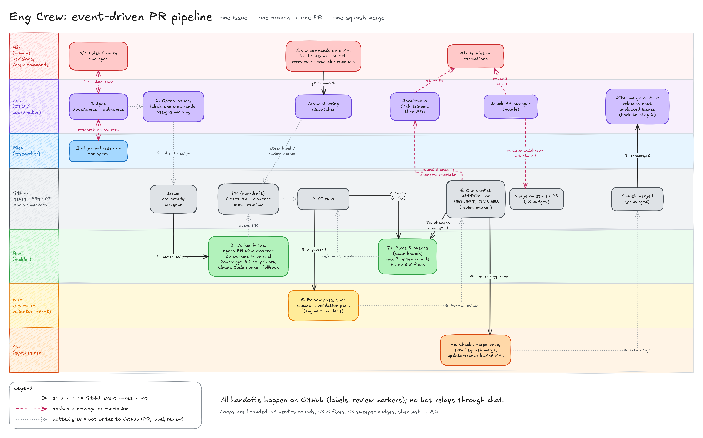

# eng-crew

eng-crew is a versioned, reviewed rulebook for running a GitHub repo with a
small crew of bots. Each bot has one job: coordinate, build, review and
validate, or merge. Together they take an issue from spec to merged PR with
CI, evidence and a human-readable trail at every step. It exists because
"let an AI write code" falls apart without clear roles, gates and a record of
who did what; this repo writes those rules down and keeps them testable.

## How it works

A coordinator turns a spec into issues with numbered acceptance criteria. A
builder picks each issue up and opens a PR with evidence. CI runs. A reviewer
and validator, a different identity from the author, post a verdict. When the
gate passes, the synthesizer merges and the coordinator closes out. Loops are
capped, and every handoff is a marker on the PR.



*Crew collaboration flow.* Editable source:
[eng-crew-flow.excalidraw](docs/diagrams/eng-crew-flow.excalidraw)
(see [docs/diagrams/README.md](docs/diagrams/README.md)).

- Stages, markers, rounds and the merge gate: [docs/protocol.md](docs/protocol.md)
- Roles, tiers and engines: [docs/roles.md](docs/roles.md)

## Who it's for

- Maintainers who want bots to build and review changes in their repo without
  giving up a merge gate.
- Engineers adopting the crew on a new repo, via the
  [onboarding runbook](docs/runbook-new-repo.md).

## What you get

- A staged protocol with typed evidence, review rounds and a merge gate.
- Routine and listener templates per role, with placeholders only
  ([templates/](templates/README.md)).
- A seed README for product repos ([templates/product-readme.md](templates/product-readme.md)).
- Guard scripts that scan for secrets and check docs and links in CI.
- A lessons log and a changelog of every change.
- Versioned releases of the installable parts: what ships, how it is
  versioned and what each version promises is in
  [docs/deliverables.md](docs/deliverables.md); how a release is cut is in
  [docs/release.md](docs/release.md). Install a tagged version from
  [GitHub Releases](https://github.com/mw-ding/eng-crew/releases), as in
  [Install](#install).

## Install

1. **Needs:** Python 3.11+, and `gh` logged in with read access to
   `mw-ding/eng-crew` (the repo is private, so a plain `curl` gets a 404).
   The tmux runtime also needs tmux.
2. **Download and verify** the latest release (to pin a version, pass its
   tag: `gh release download vX.Y.Z ...`):

   ```bash
   gh release download -R mw-ding/eng-crew --pattern 'eng-crew-*.tar.gz' --pattern SHA256SUMS -D eng-crew-release
   cd eng-crew-release && shasum -a 256 -c SHA256SUMS  # Linux: sha256sum -c SHA256SUMS
   ```

3. **Extract:** `tar -xzf eng-crew-*.tar.gz`. The `eng-crew-<version>/`
   directory is `<eng-crew>` in the runbook, and its `VERSION` file
   (`cat eng-crew-<version>/VERSION`) is the version to record
   ([release.md: Update path](docs/release.md#update-path)).
4. **Check the tools run:**
   `python3 eng-crew-<version>/scripts/crew-config.py validate eng-crew-<version>/profiles/default.toml`
   and `eng-crew-<version>/scripts/crew --help`.
5. **Next:** write `crew.toml` and continue at the runbook's
   [Step 0](docs/runbook-new-repo.md#step-0-write-validate-and-render-the-profile)
   (Grok Bot) or its [tmux runtime](docs/runbook-new-repo.md#tmux-runtime)
   section. Upgrades follow [release.md: Update path](docs/release.md#update-path).

The `v2.0.0` bundle lacks a file the install CLI needs, so step 4 fails on it;
use a release with the [#275](https://github.com/mw-ding/eng-crew/issues/275) fix.

## Status

- **v1 cut: M1–M12 closed** (harness loop through the `AGENTS.md` thin review
  posture), locked 2026-10-29 and released as
  [`v1.0.0`](https://github.com/mw-ding/eng-crew/releases/tag/v1.0.0).
- **M13 configurable core (profiles, renderer, packs): done**, except the
  live box-skill sync ([#140](https://github.com/mw-ding/eng-crew/issues/140)).
- **M14 and M14.1 tmux crew runtime: done.** Binding:
  [docs/runtimes/tmux.md](docs/runtimes/tmux.md); operator steps: the
  runbook's [tmux runtime](docs/runbook-new-repo.md#tmux-runtime) section.
- **R1 versioned release: done.**
  [`v2.0.0`](https://github.com/mw-ding/eng-crew/releases/tag/v2.0.0) was
  released through `release.yml`; its bundle fix is
  [#275](https://github.com/mw-ding/eng-crew/issues/275).
- Per-slice status: [docs/specs/portable.md](docs/specs/portable.md) §5. See
  also [CHANGELOG.md](CHANGELOG.md) and the
  [closed milestones](https://github.com/mw-ding/eng-crew/milestones?state=closed).
- **Out of cut / held:** the Sam-only merge ruleset
  ([#80](https://github.com/mw-ding/eng-crew/issues/80), needs GitHub Pro or an
  App; stays on `crew:hold`), and the product prove-it apps (they live
  elsewhere, not in eng-crew).
- **Canonical heading:** the
  [Personal AI swarm harness brief](https://www.notion.so/408223c9b3db81809f9bfe3985251c8b)
  is the gap-table north star. It is not a second source of truth for protocol
  text: the repo docs win for normative crew rules.

Content is built by the crew itself through the normal PR pipeline; every
change is recorded in `CHANGELOG.md`.

## More

- Spec: [docs/specs/framework.md](docs/specs/framework.md)
- Lessons log: [docs/lessons/](docs/lessons/README.md)
- Changes: [CHANGELOG.md](CHANGELOG.md) · Process: [CONTRIBUTING.md](CONTRIBUTING.md)
- No secrets or tokens are ever committed here. Per-repo specifics are templates
  with placeholders.
