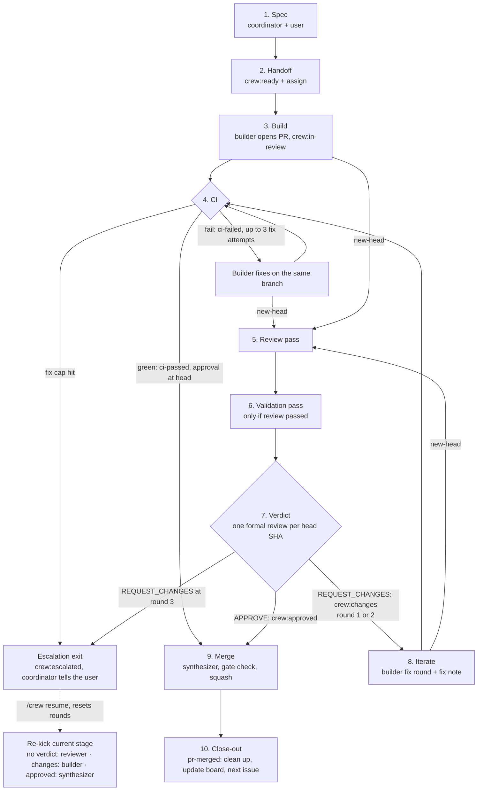
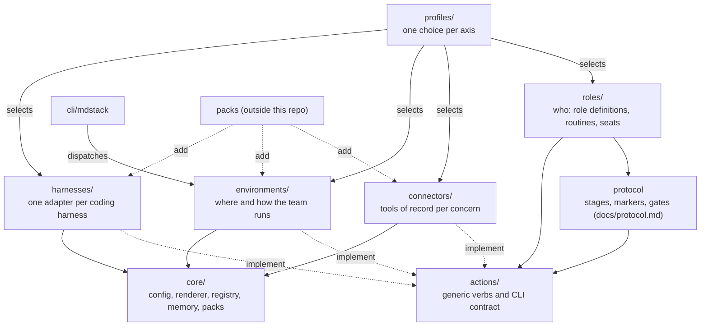

# Architecture overview

A crew of bots runs a GitHub repo's loop of spec, build, CI, review,
validation and merge. One issue becomes one branch, one PR and one squash merge.
Each stage is woken by a GitHub event, does its job through fresh workers, and
leaves its result on GitHub (labels, markers, a formal review) so the next stage
can read that state. Nothing important lives only in a bot's chat.

This page covers roles, identities, stages, labels, markers and the
[modules](#modules) the team is built from. Full protocol
detail is in [protocol.md](protocol.md). Worker roles, tiers and engines are in
[roles.md](roles.md). See the [docs index](README.md).

Placeholders used below: `<owner>`, `<repo>`, `<author-login>`,
`<reviewer-login>`, `<BotName>`, `<default-branch>`, `<state-dir>`.


*The crew collaboration flow, from spec to merge.
Editable source: [eng-crew-flow.excalidraw](diagrams/eng-crew-flow.excalidraw).*

## Roles

Five roles run the loop: the coordinator (also the **steering dispatcher**),
researcher, builder, reviewer-validator and synthesizer. Who wakes each role,
what it owns and which identity it uses are defined in
[protocol §1](protocol.md#1-roles-and-identities). Worker scope, tiers and
engines are in [roles.md](roles.md).

Only role bots post to GitHub. Short-lived workers do the coding and reviewing,
and report back to their role bot.

## Identities

The crew uses two GitHub identities: the **author identity**
(`<author-login>`) and the **reviewer identity** (`<reviewer-login>`), which
must differ from the PR author. Which role uses which, and why GitHub needs
them to differ, is in the [GitHub backend](backends/github.md#identities).

Several bots share each account, so bot identity comes from the signed marker,
not the account ([protocol §1](protocol.md#1-roles-and-identities); see
[Markers](#markers)).

## Stages



The diagram is the explanatory path. Each stage's duties are defined in
[protocol §2](protocol.md#2-stages), verdict rounds and the escalation exit in
[§5](protocol.md#5-rounds-and-escalation), and the merge gate in
[§7](protocol.md#7-merge-gate-synthesizer).

## Labels

Labels are safe state because no listener fires on labels. These are the eleven
`crew:*` labels in this repo. This table is the role view; GitHub specifics
(colours, label events, milestones, board and issue linkage) are in the
[GitHub backend: Tracking](backends/github.md#tracking).

| Label | Meaning | Set by | Cleared by |
|---|---|---|---|
| `crew:ready` | Released to the builder; the issue may be assigned and built | Coordinator | Coordinator, once the issue is done |
| `crew:in-review` | PR open, awaiting CI, review and validation | Builder, when the PR opens | Reviewer-validator, in the same step that sets `crew:approved` or `crew:changes` |
| `crew:changes` | Reviewer requested changes; a builder fix round is due | Reviewer-validator, on `REQUEST_CHANGES` | Reviewer-validator, on the next verdict |
| `crew:approved` | Reviewer approved at head; the synthesizer may merge | Reviewer-validator, on `APPROVE` | Reviewer-validator, on a later verdict at a new head |
| `crew:escalated` | Round cap or CI-fix cap hit, or escalated by hand; work roles do nothing until `/crew resume`; coordinator and sweeper still monitor waits | Reviewer-validator or builder at a cap; coordinator at the sweeper nudge cap or on `/crew escalate` | Coordinator, on `/crew resume` |
| `crew:hold` | Paused: work roles do nothing on this item; coordinator and sweeper still monitor waits | Coordinator, on `/crew hold` or by the user | Coordinator, on `/crew resume` |
| `crew:external` | External (fork) PR: sandboxed validation, no tokens | Reviewer-validator, on `pr-opened` | Not cleared; stays for the life of the PR |
| `crew:spec` | Spec PR: review pass only, merges on `/crew merge-ok` | Coordinator, when opening the spec PR | Not cleared; stays for the life of the PR |
| `crew:express` | Express lane: one builder builds and self-gates; no reviewer verdict ([protocol §3](protocol.md#change-flavor)) | Coordinator, with the `express` item record | Builder, on [fallback](express-lane.md#eligibility) to the crew lane (it tells the coordinator) |
| `crew:needs-md` | Blocked on a decision from the human owner, with a recommended default and a deadline | Coordinator or its sweeper; reviewer-validator for an intentional verdict hold | Coordinator, once the owner decides |
| `crew:needs-mirror` | Protocol/template change: the synthesizer refuses to merge until the box skill is mirrored | Reviewer-validator, in its verdict pass, on PRs changing `docs/protocol.md` or `templates/`, before it posts the formal review, unless the mirror comment is already newer than the last commit touching those paths | Coordinator, when it posts the box-skill mirror comment (fresh one after any later such commit); it then pings the synthesizer, because label changes don't wake listeners |

Bots never touch labels or comment commands that belong to the product under
development.

## Markers

Each stage leaves its result as a signed bot post that the next stage reads
back. A post body opens with a visible signed header and carries one hidden
`crew:v1` line, for example a builder's fix note:

```text
[<BotName>/fix] round <k> @ <sha7>
...
<!-- crew:v1 role=builder pass=fix pr=<n> sha=<40-char head sha> round=<k> verdict=n/a engine=<engine> model=<model> effort=<effort> -->
```

Where bots write, the marker schema, every `pass` value and what it means,
and the rules for reading markers are defined in
[protocol §4](protocol.md#4-marker-conventions). The builder's PR body line
and fix-note fields are in [protocol §3](protocol.md#3-evidence-requirements),
round counting in [§5](protocol.md#5-rounds-and-escalation), skipping a pass
already done at head in [§6](protocol.md#6-duties-on-wake-all-roles), and the
actual writing engine in [roles](roles.md#actual-builder-engine).

## Modules

A deployment is the product of four independent axes: **roles** (who),
**connectors** (the tools of record), **environments** (where and how the
team runs) and **harnesses** (how an agent launches and loads). The profile
picks one value per axis; roles name generic actions, and the other three
axes implement them. Terms are in [concepts: Four axes](concepts.md#four-axes);
each module's README is linked from the [docs index](README.md#modules).



*Solid arrows: may reference (dependency rules D1–D4 and D8 in
[specs/team.md §5](specs/team.md#5-dependency-rules)); dotted: implements or
extends. No binding module references another except through `actions/` or a
declared capability (D3). The protocol is not yet its own `protocols/`
module; it lives in [protocol.md](protocol.md).*
