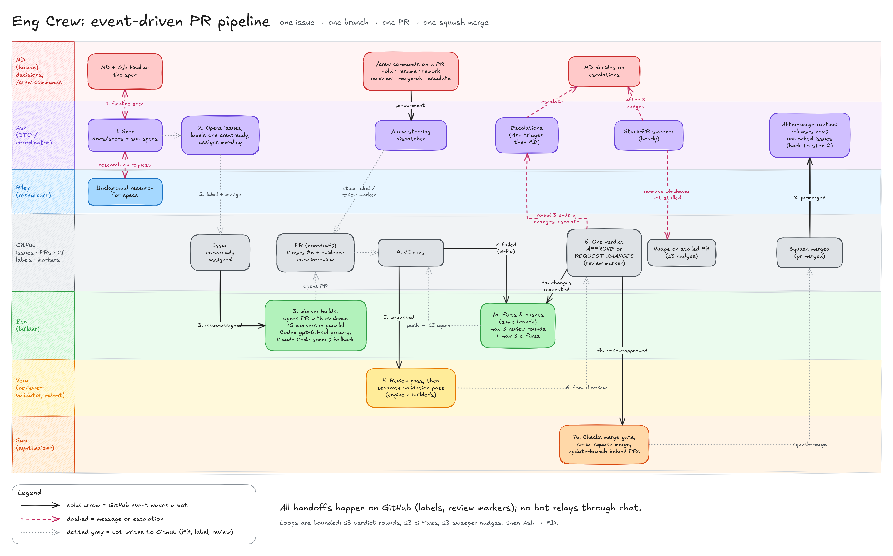
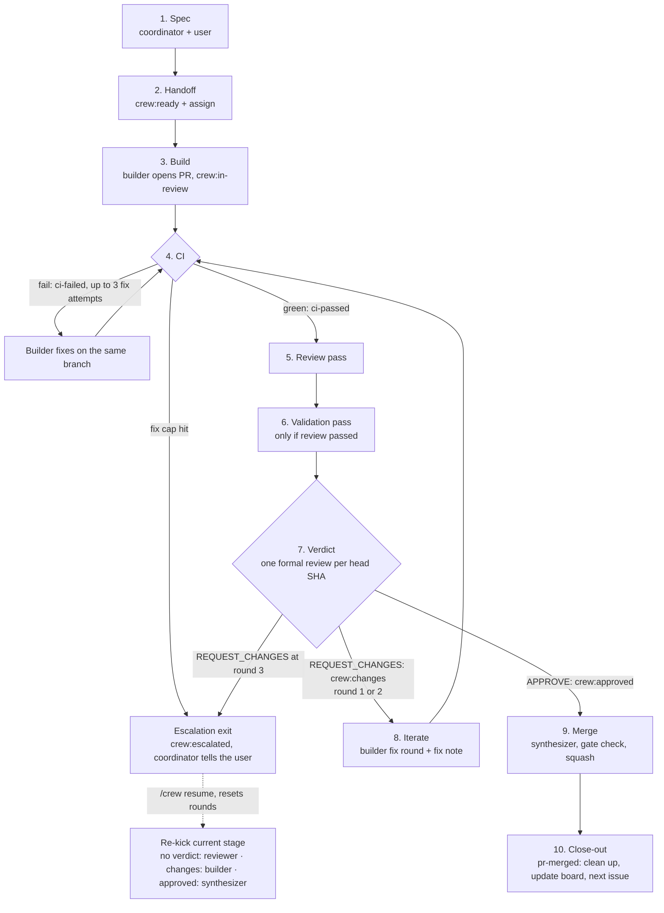

# Architecture overview

A crew of bots runs a GitHub repo's loop of spec, build, CI, review,
validation and merge. One issue becomes one branch, one PR and one squash merge.
Each stage is woken by a GitHub event, does its job through fresh workers, and
leaves its result on GitHub (labels, markers, a formal review). The next stage
reads that state. Nothing important lives only in a bot's chat.

This page covers roles, identities, stages, labels and markers. Full protocol
detail is in [protocol.md](protocol.md). Worker roles, tiers and engines are in
[roles.md](roles.md). See the [docs index](README.md).

Placeholders used below: `<owner>`, `<repo>`, `<author-login>`,
`<reviewer-login>`, `<BotName>`, `<default-branch>`, `<state-dir>`.



*The crew collaboration flow, from spec to merge.
Editable source: [eng-crew-flow.excalidraw](diagrams/eng-crew-flow.excalidraw).*

## Roles

| Role | Woken by | Owns | GitHub identity |
|---|---|---|---|
| Coordinator (also the **steering dispatcher**) | The user (chat), escalations, `pr-merged`, `pr-comment`, `inline-review-comment` | Spec, issues, Project board, escalations, next assignment, `/crew` commands | Author identity (`<author-login>`); reviewer identity (`<reviewer-login>`) for steering signals |
| Researcher | The coordinator's message | Research notes for specs; no PRs unless asked | Author identity |
| Builder | `issue-assigned`, `review-changes-requested`, `ci-failed` | Branches, commits, PRs, fix rounds, conflict resolution | Author identity |
| Reviewer-validator | `pr-opened`, `ci-passed`, `review-requested` | Review pass, validation pass, the one formal verdict | Reviewer identity (`<reviewer-login>`), which must differ from the PR author |
| Synthesizer | `review-approved` | Merge gate check, serial squash merge, update-branch of PRs that fall behind | Author identity (later: its own App identity) |

Only role bots post to GitHub. Short-lived workers do the coding and reviewing,
and report back to their role bot.

## Identities

The crew uses two GitHub identities:

- **Author identity** (`<author-login>`): used by the coordinator, researcher,
  builder and synthesizer. It opens branches and PRs and does the merge.
- **Reviewer identity** (`<reviewer-login>`): used by the reviewer-validator to
  submit the formal `APPROVE` or `REQUEST_CHANGES` review. The coordinator also
  uses it to post steering signals.

**The reviewer identity must differ from the PR author.** GitHub refuses
`APPROVE` and `REQUEST_CHANGES` reviews from the author of a PR. With a separate
reviewer account, the formal verdict is always accepted and always comes from a
different party than the code's author.

**Bot identity comes from the signed marker, not the account.** Several bots
share each account, so GitHub actor filters cannot tell them apart. Which bot
did something is read from the signed header `[<BotName>/<pass>]` and the hidden
`crew:v1` line in the review body (see [Markers](#markers)).

## Stages



1. **Spec.** The coordinator writes the spec and one sub-spec per buildable
   slice. It lands them through a `crew:spec` PR, then opens one issue per
   slice with a goal, numbered testable acceptance criteria, out-of-scope items,
   a spec link, a role and tier hint, and dependencies. Heavy research goes to
   the researcher in the background.
2. **Handoff.** The coordinator adds `crew:ready` and assigns the issue to the
   author identity. The `issue-assigned` event wakes the builder.
3. **Build.** The builder fans out one worker per issue. The worker builds, runs
   tests and build, and opens a non-draft PR with `Closes #<n>` and an evidence
   body. The builder labels it `crew:in-review`.
4. **CI.** Checks must settle green. `ci-failed` wakes the builder, who fixes on
   the same branch. After 3 CI-fix attempts the PR escalates. `ci-passed` wakes
   the reviewer-validator.
5. **Review.** A fresh worker reviews code, design and implementation against
   the PR body and the issue.
6. **Validation.** Runs only if review passed. A separate fresh worker, which has
   not seen the review, gathers its own evidence and judges whether the
   builder's evidence matches the spec.
7. **Verdict.** The reviewer-validator submits one formal review per head SHA:
   `APPROVE` if review and validation both passed, otherwise `REQUEST_CHANGES`.
   It sets `crew:approved` or `crew:changes`.
8. **Iterate.** `review-changes-requested` wakes the builder, who fixes on the
   same branch and posts a fix note. The loop goes back through CI and review.
   The 3rd `REQUEST_CHANGES` escalates.
9. **Merge.** `review-approved` wakes the synthesizer. It checks the merge gate
   at the current head SHA and squash-merges, one PR at a time. Then it
   update-branches other crew PRs that fell behind.
10. **Close-out.** `pr-merged` wakes the builder (clean up the worktree) and the
    coordinator (update the board, unblock dependents, assign the next
    `crew:ready` issue).

**Escalation exit.** A PR leaves the loop with `crew:escalated` when the 3rd
verdict round ends in `REQUEST_CHANGES` or the CI-fix cap is hit. The
reviewer-validator or builder posts an `escalation` review (open blockers, what
was tried, decision needed) and tells the coordinator, who brings it to the
user. Bots do nothing on that PR until `/crew resume`, which resets the round
count.

## Labels

Labels are safe state because no listener fires on labels. These are the nine
`crew:*` labels in this repo.

| Label | Meaning | Set by | Cleared by |
|---|---|---|---|
| `crew:ready` | Released to the builder; the issue may be assigned and built | Coordinator | Coordinator, once the issue is done |
| `crew:in-review` | PR open, awaiting CI, review and validation | Builder, when the PR opens | Reviewer-validator, in the same step that sets `crew:approved` or `crew:changes` |
| `crew:changes` | Reviewer requested changes; a builder fix round is due | Reviewer-validator, on `REQUEST_CHANGES` | Reviewer-validator, on the next verdict |
| `crew:approved` | Reviewer approved at head; the synthesizer may merge | Reviewer-validator, on `APPROVE` | Reviewer-validator, on a later verdict at a new head |
| `crew:escalated` | Round cap or CI-fix cap hit, or escalated by hand; bots do nothing until `/crew resume` | Reviewer-validator or builder at a cap; coordinator on `/crew escalate` | Coordinator, on `/crew resume` |
| `crew:hold` | Paused: every bot does nothing on this item | Coordinator, on `/crew hold` or by the user | Coordinator, on `/crew resume` |
| `crew:external` | External (fork) PR: sandboxed validation, no tokens | Reviewer-validator, on `pr-opened` | Not cleared; stays for the life of the PR |
| `crew:spec` | Spec PR: review pass only, merges on `/crew merge-ok` | Coordinator, when opening the spec PR | Not cleared; stays for the life of the PR |
| `crew:needs-md` | Blocked on a decision from the human owner, with a recommended default and a deadline | Any bot that needs the decision, usually via the coordinator (provisional, slice B) | Coordinator, once the owner decides (provisional, slice B) |

Bots never touch labels or comment commands that belong to the product under
development.

## Markers

### Where bots write

Bots never post plain PR conversation comments or inline comments. Those fire
`pr-comment` and `inline-review-comment` and wake the steering dispatcher for
nothing. All bot output goes in review bodies:

- A **COMMENT review** for narrative: acknowledgements, fix notes, merge-up,
  merge, escalation and steering acks.
- The **formal `APPROVE` or `REQUEST_CHANGES` review** for verdicts and steering
  signals. Cite `file:line` in the body instead of using inline comments.

**No bot text ever starts with `/crew`**, in any comment, review or commit
message. A `/crew` first line is a steering command, and only the user's own
accounts may issue one.

### Signed header

Every bot-authored review body starts with a visible signed header:

```text
[<BotName>/<pass>] <short status>
```

`<BotName>` names the bot that wrote the review. `<pass>` names the kind of
pass. This header, together with the hidden line below, is how a bot is
identified.

### Hidden `crew:v1` line

Every bot-authored review body also carries a hidden machine line:

```text
<!-- crew:v1 role=<role> pass=<pass> pr=<n> sha=<40-char head sha> round=<k> verdict=<result> -->
```

| Field | Meaning |
|---|---|
| `role` | The role that wrote it: coordinator, researcher, builder, reviewer, or synthesizer |
| `pass` | The kind of pass; see the list below |
| `pr` | PR number |
| `sha` | Full 40-character head SHA the marker applies to |
| `round` | Verdict round number `k`, starting at 1 |
| `verdict` | `pass`, `changes`, or `n/a` |

A `steer` marker adds `cmd=<command>` and `cmd-id=<comment id>`.

A builder's PR body carries a different hidden line, written once at PR
creation, just before the signature:

```text
<!-- crew:v1 role=builder issue=<n> tier=<tier> engine=<engine> model=<model> -->
```

A fix or ci-fix note's marker also carries `engine=`, `model=` and `effort=`
naming the engine that actually wrote that round (see
[roles](roles.md#actual-builder-engine)).

Rules for reading markers:

- Parse only the hidden line, never the visible text. (Exception: to find a
  round's actual builder engine, the fix note and commit trailers also count and
  win over the marker; see [roles](roles.md#actual-builder-engine).)
- Markers are append-only. A marker for a newer SHA supersedes older ones.
- A marker for a given pass at a given head SHA means that pass is done. Do not
  repeat it.
- The round count is derived from GitHub each time: 1 plus the number of
  reviewer-identity formal reviews with `pass=verdict verdict=changes`, counted
  after the latest `cutover` or `resume` marker.

### Pass values

| `pass` | Written when |
|---|---|
| `ack` | The reviewer-validator acknowledges a newly opened PR |
| `review` | The review section of a verdict |
| `validate` | The validation section of a verdict |
| `verdict` | The formal review; its body holds the review and validation sections, each with its own marker line |
| `fix` | The builder pushes a fix round |
| `ci-fix` | The builder pushes a CI fix |
| `merge-up` | The synthesizer brings a PR up to date with `<default-branch>` |
| `merge` | The synthesizer merges the PR |
| `escalation` | A PR is escalated |
| `resume` | `/crew resume` clears a hold or escalation and resets rounds |
| `cutover` | Control of a PR moves from another system to the crew |
| `steer` | The steering dispatcher acknowledges a `/crew` command; adds `cmd` and `cmd-id` |
