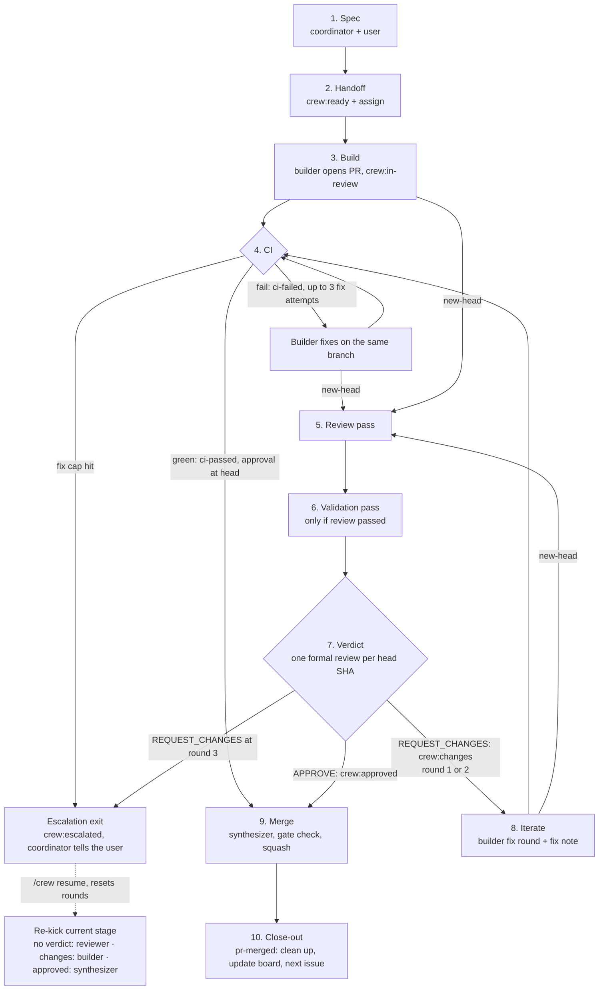

# Architecture overview

A crew of bots runs a GitHub repo's loop of spec, build, CI, review,
validation and merge. One issue becomes one branch, one PR and one squash merge.
Each stage is woken by a GitHub event, does its job through fresh workers, and
leaves its result on GitHub (labels, markers, a formal review) so the next stage
can read that state. Nothing important lives only in a bot's chat.

This page covers roles, identities, stages, labels and markers. Full protocol
detail is in [protocol.md](protocol.md). Worker roles, tiers and engines are in
[roles.md](roles.md). See the [docs index](README.md).

Placeholders used below: `<owner>`, `<repo>`, `<author-login>`,
`<reviewer-login>`, `<BotName>`, `<default-branch>`, `<state-dir>`.


*The crew collaboration flow, from spec to merge.
Editable source: [eng-crew-flow.excalidraw](diagrams/eng-crew-flow.excalidraw).*

## Roles

Five roles run the loop: the coordinator (also the **steering dispatcher**),
researcher, builder, reviewer-validator and synthesizer. Who wakes each role,
what it owns and which identity it uses are defined in
[protocol §1](protocol.md#1-roles-and-identities). Worker scope, tiers and
engines are in [roles.md](roles.md).

Only role bots post to GitHub. Short-lived workers do the coding and reviewing,
and report back to their role bot.

## Identities

The crew uses two GitHub identities: the **author identity**
(`<author-login>`) and the **reviewer identity** (`<reviewer-login>`), which
must differ from the PR author. Which role uses which, and why GitHub needs
them to differ, is in the [GitHub backend](backends/github.md#identities).

Several bots share each account, so bot identity comes from the signed marker,
not the account ([protocol §1](protocol.md#1-roles-and-identities); see
[Markers](#markers)).

## Stages



The diagram is the explanatory path. Each stage's duties are defined in
[protocol §2](protocol.md#2-stages), verdict rounds and the escalation exit in
[§5](protocol.md#5-rounds-and-escalation), and the merge gate in
[§7](protocol.md#7-merge-gate-synthesizer).

## Labels

Labels are safe state because no listener fires on labels. These are the eleven
`crew:*` labels in this repo. This table is the role view; GitHub specifics
(colours, label events, milestones, board and issue linkage) are in the
[GitHub backend: Tracking](backends/github.md#tracking).

| Label | Meaning | Set by | Cleared by |
|---|---|---|---|
| `crew:ready` | Released to the builder; the issue may be assigned and built | Coordinator | Coordinator, once the issue is done |
| `crew:in-review` | PR open, awaiting CI, review and validation | Builder, when the PR opens | Reviewer-validator, in the same step that sets `crew:approved` or `crew:changes` |
| `crew:changes` | Reviewer requested changes; a builder fix round is due | Reviewer-validator, on `REQUEST_CHANGES` | Reviewer-validator, on the next verdict |
| `crew:approved` | Reviewer approved at head; the synthesizer may merge | Reviewer-validator, on `APPROVE` | Reviewer-validator, on a later verdict at a new head |
| `crew:escalated` | Round cap or CI-fix cap hit, or escalated by hand; work roles do nothing until `/crew resume`; coordinator and sweeper still monitor waits | Reviewer-validator or builder at a cap; coordinator at the sweeper nudge cap or on `/crew escalate` | Coordinator, on `/crew resume` |
| `crew:hold` | Paused: work roles do nothing on this item; coordinator and sweeper still monitor waits | Coordinator, on `/crew hold` or by the user | Coordinator, on `/crew resume` |
| `crew:external` | External (fork) PR: sandboxed validation, no tokens | Reviewer-validator, on `pr-opened` | Not cleared; stays for the life of the PR |
| `crew:spec` | Spec PR: review pass only, merges on `/crew merge-ok` | Coordinator, when opening the spec PR | Not cleared; stays for the life of the PR |
| `crew:express` | Express lane: one builder builds and self-gates; no reviewer verdict ([protocol §3](protocol.md#change-flavor)) | Coordinator, with the `express` item record | Builder, on [fallback](express-lane.md#eligibility) to the crew lane (it tells the coordinator) |
| `crew:needs-md` | Blocked on a decision from the human owner, with a recommended default and a deadline | Coordinator or its sweeper; reviewer-validator for an intentional verdict hold | Coordinator, once the owner decides |
| `crew:needs-mirror` | Protocol/template change: the synthesizer refuses to merge until the box skill is mirrored | Reviewer-validator, in its verdict pass, on PRs changing `docs/protocol.md` or `templates/`, before it posts the formal review, unless the mirror comment is already newer than the last commit touching those paths | Coordinator, when it posts the box-skill mirror comment (fresh one after any later such commit); it then pings the synthesizer, because label changes don't wake listeners |

Bots never touch labels or comment commands that belong to the product under
development.

## Markers

### Where bots write

Bots never post plain PR conversation comments or inline comments. Those fire
`pr-comment` and `inline-review-comment` and wake the steering dispatcher for
nothing. All bot output goes in review bodies:

- A **COMMENT review** for narrative: acknowledgements, fix notes, merge-up,
  merge, escalation and steering acks.
- The **formal `APPROVE` or `REQUEST_CHANGES` review** for verdicts and steering
  signals. Cite `file:line` in the body instead of using inline comments.

**No bot text ever starts with `/crew`**, in any comment, review or commit
message. A `/crew` first line is a steering command, and only the user's own
accounts may issue one.

### Signed header

Every bot-authored review body starts with a visible signed header:

```text
[<BotName>/<pass>] <short status>
```

`<BotName>` names the bot that wrote the review. `<pass>` names the kind of
pass. This header, together with the hidden line below, is how a bot is
identified.

### Hidden `crew:v1` line

Every bot-authored review body also carries a hidden machine line:

```text
<!-- crew:v1 role=<role> pass=<pass> pr=<n> sha=<40-char head sha> round=<k> verdict=<result> -->
```

| Field | Meaning |
|---|---|
| `role` | The role that wrote it: coordinator, researcher, builder, reviewer, or synthesizer |
| `pass` | The kind of pass; see the list below |
| `pr` | PR number |
| `sha` | Full 40-character head SHA the marker applies to |
| `round` | Verdict round number `k`, starting at 1 (protocol §5); `n/a` for a merge-up ack. A builder fix or ci-fix note carries the round of the verdict it answers, or `0` before any verdict |
| `verdict` | `pass`, `changes`, or `n/a` |

A `steer` marker adds `cmd=<command>` and `cmd-id=<comment id>`.

A builder's PR body carries a different hidden line, written once at PR
creation, just before the signature:

```text
<!-- crew:v1 role=builder issue=<n> tier=<tier> engine=<engine> model=<model> -->
```

A fix or ci-fix note's marker also carries `engine=`, `model=` and `effort=`
naming the engine that actually wrote that round (see
[roles](roles.md#actual-builder-engine)).

Rules for reading markers:

- Parse only the hidden line, never the visible text. (Exception: to find a
  round's actual builder engine, the fix note and commit trailers also count and
  win over the marker; see [roles](roles.md#actual-builder-engine).)
- Markers are append-only. A marker for a newer SHA supersedes older ones.
- A marker for a given pass at a given head SHA means that pass is done. Do not
  repeat it.
- The round count is derived from GitHub each time: 1 plus the number of
  reviewer-identity formal reviews with `pass=verdict verdict=changes`, counted
  after the latest `cutover` or `resume` marker.

### Pass values

| `pass` | Written when |
|---|---|
| `ack` | The reviewer-validator acknowledges a newly opened PR, or a clean merge-up after changes (no round, no verdict) |
| `review` | The review section of a verdict |
| `validate` | The validation section of a verdict |
| `verdict` | The formal review; its body holds the review and validation sections, each with its own marker line |
| `hold` | The reviewer-validator holds its verdict for a user decision and adds `crew:needs-md` (COMMENT review; no round, `verdict=n/a`) |
| `watch` | The builder's parent turn confirms the per-PR watch B2 is attached (`watch=b2 status=attached`); no round, no verdict |
| `fix` | The builder pushes a fix round |
| `selfgate` | The builder records the self-gate for an express change at head (no round; `verdict=pass` or `changes`) |
| `ci-fix` | The builder pushes a CI fix |
| `merge-up` | The synthesizer brings a PR up to date with `<default-branch>` |
| `merge` | The synthesizer merges the PR |
| `escalation` | A PR is escalated |
| `resume` | `/crew resume` clears a hold or escalation and resets rounds |
| `cutover` | Control of a PR moves from another system to the crew |
| `steer` | The steering dispatcher acknowledges a `/crew` command; adds `cmd` and `cmd-id` |
| `triage` | A [triage sweep](triage.md) records its decision on a tracker item (`issue`, `decision`, `priority`, `mode`, `sweep`; no SHA, no round); a note, never a gate input |
| `triage-log` | A triage sweep's one comment on the day's log issue (`sweep`, `applied`, `proposed`, `skipped`) |
