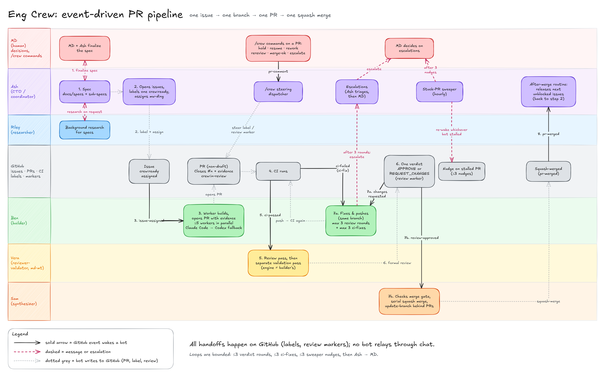

# Diagrams

## eng-crew-flow



The crew collaboration flow: how the bots hand work to each other through the
GitHub spec → build → CI → review → validation → merge loop.

- Editable source: [eng-crew-flow.excalidraw](eng-crew-flow.excalidraw)
- Export: [eng-crew-flow.png](eng-crew-flow.png) (4500x2805)

## How to edit

Either:

1. Open `eng-crew-flow.excalidraw` at [excalidraw.com](https://excalidraw.com)
   via **File > Open**, edit, save the `.excalidraw` back over the file, and
   re-export the PNG; or
2. Edit the scene definition `render/scene.mjs` and run the headless render
   (below), which rewrites both the `.excalidraw` and the PNG.

## Rendering from `scene.mjs`

Requires Node.js and a Chrome/Chromium binary.

```sh
cd docs/diagrams/render
npm ci
npm run build   # bundles entry.js into bundle.js (generated, git-ignored)
node render.mjs # writes ../eng-crew-flow.excalidraw and ../eng-crew-flow.png
```

`render.mjs` launches Chrome from `/usr/bin/google-chrome` by default. Set
`CHROME_PATH` to use another binary:

```sh
CHROME_PATH=/usr/bin/chromium node render.mjs
```

`bundle.js` and `node_modules/` are generated and never committed. A re-render
is not byte-for-byte reproducible (Excalidraw assigns random seeds), so only
re-render when you intend to change the diagram.

## Rule: keep the PNG in sync

The PNG must be regenerated from the `.excalidraw` **in the same PR** whenever
either file changes. Never commit one without the other.
