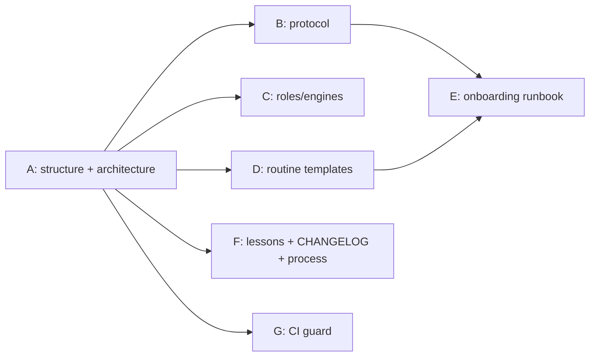

# Spec: engineering-bot crew framework

Status: draft v0.1 (bootstrap, Oct 19, 2026). Owner: coordinator. Changes land
through `crew:spec` PRs (review pass only, merge on `/crew merge-ok`).

## 1. Goal

A **versioned, generic, sanitized source of truth** for the engineering-bot
crew framework, so it can be reviewed, reused on new repos, and iterated as the
crew learns. It covers:

1. Roles and GitHub identities.
2. Stages (spec → handoff → build → CI → review → validation → verdict →
   iterate → merge → close-out).
3. Evidence requirements (PR body, fix-round notes, review and validation
   sections).
4. Markers (signed headers + hidden `crew:v1` lines) and labels.
5. Rounds and escalation.
6. Steering (`/crew` commands).
7. Merge gate.
8. Safety rules.
9. Engines, tiers and quota routing.
10. Worker isolation (unique worktrees, cleanup, toolchain pinning).
11. Routine / listener templates per role, with trigger JSON.
12. An onboarding runbook for wiring a new repo.
13. A dated lessons log.
14. A process for iterating on all of the above.

## 2. Requirements

- **R1. No secrets.** No tokens, API keys, auth headers, private URLs with
  credentials, or token-shaped strings anywhere in the repo, including examples.
  Refer to credentials only by mechanism (e.g. `GH_TOKEN=$(gh auth token --user <author-login>)`).
- **R2. Generic with placeholders.** Per-repo specifics become templates using
  placeholders such as `<owner>`, `<repo>`, `<default-branch>`,
  `<author-login>`, `<reviewer-login>`, `<user-logins>`, `<state-dir>`,
  `<CoordinatorBot>`, `<BuilderBot>`, `<ReviewerBot>`, `<SynthesizerBot>`.
- **R3. Worked example.** The agentconnect pilot (`mw-ding/agentconnect`) is
  kept as a clearly labelled worked example, sanitized per R1.
- **R4. Two copies, kept in sync.** The box skills remain the **live** copies
  the bots load; this repo is the **reviewed** source. Any change to either must
  be mirrored to the other via a PR in this repo (and a matching edit to the box
  copy) in the same change.
- **R5. CHANGELOG.** `CHANGELOG.md` records every change (date, PR, summary,
  whether the box copy was updated).
- **R6. CI green.** markdownlint and an offline relative-link check pass on
  every PR and on `main`; slice G adds a guard for R1 and required docs.
- **R7. Content is crew-built.** Apart from this spec, the README and CI
  bootstrap, all content arrives through the normal PR pipeline.

## 3. Target layout

| Path | Contents | Slice |
|---|---|---|
| `docs/README.md` | docs index | A |
| `docs/architecture.md` | roles, identities, stages diagram (mermaid), label and marker reference | A |
| `docs/protocol.md` | stage protocol (port of `eng-pr-pipeline`) | B |
| `docs/roles.md` | roles, tiers, engines, quota routing, worktree rules, worker brief template (port of `eng-crew-roles`) | C |
| `templates/` | routine/listener prompt templates per role with trigger JSON, `wiring.md` template, reviewer-engine and V2 templates | D |
| `examples/agentconnect/` | sanitized worked example | D |
| `docs/runbook-new-repo.md` | onboarding runbook and verification checklist | E |
| `docs/lessons/` | dated lessons log, starting with `2026-10-19-bottlenecks.md` | F |
| `CHANGELOG.md`, `CONTRIBUTING.md` | change record and iteration process | F |
| `scripts/` + CI step | secret/token scan, required-docs/sections check, link check | G |

## 4. Source material (on the box)

Builders port from these; reviewers check the port against them. The live
copies stay on the box (R4).

| Source | Feeds |
|---|---|
| `/home/box/agent-data/workflows/eng-pr-pipeline/SKILL.md` (stage protocol: roles/identities, stages, evidence, markers, rounds, duties on wake, merge gate, safety, `/crew` steering) | A, B |
| `/home/box/agent-data/workflows/eng-crew-roles/SKILL.md` (roles, tiers, engines, quota rule, worker brief, worktrees, PR body, parallelism) | A, C |
| `/home/box/agent-data/crew/mw-ding__agentconnect/wiring.md` (per-bot routines and trigger JSON, steering wiring, state passing, enforcement, cutover, wake estimates, risks, pilot findings) | D, E |
| `/home/box/agent-data/crew/mw-ding__agentconnect/vera-engines.md` (reviewer engine choice) | C, D |
| `/home/box/agent-data/crew/mw-ding__agentconnect/vera-v2-template.md` (reviewer per-PR watch template) | D |
| `/home/box/agent-data/crew/mw-ding__agentconnect/pilot-evidence.md` (pilot #579 → PR #585 timeline and gaps) | E, F |
| `/workspace/crew-framework-src/routines.md` (coordinator routines: steering dispatcher, after-merge, stuck-PR sweeper) | D |
| `/workspace/crew-framework-src/lessons-2026-10-19.md` (bottleneck analysis, Oct 19, 2026) | F |

## 5. Slices

Each slice is one issue → one PR. Dependencies:

## 6. Iteration process (summary; detailed by slice F)

1. A lesson is observed (pilot, incident, bottleneck review) and written as a
   dated entry under `docs/lessons/`.
2. The coordinator turns each actionable lesson into an issue (goal,
   acceptance criteria, spec link).
3. The crew lands the change by PR; the PR updates the relevant doc, the
   `CHANGELOG.md`, and states how the box skill copy was mirrored (R4).
4. Spec changes go through `crew:spec` PRs.

## 7. Out of scope

- Changing how the live bots behave (that happens on the box; this repo only
  mirrors and reviews it).
- Storing any credential, quota number that identifies an account, or private
  chat transcript.
- Product code of any repo the crew works on.
