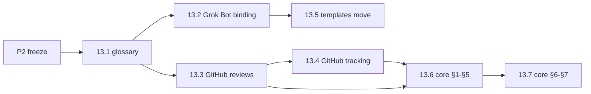

# Spec: portable eng-crew (pluggable runtimes and tools)

Status: v0.3 (2026-10-31). Owner: coordinator. Changes land through
`crew:spec` PRs (review pass only, merge on the owner's merge-ok). Umbrella:
[#110](https://github.com/mw-ding/eng-crew/issues/110).

## 1. Goal

Make eng-crew **installable on more than one agent runtime** and **workable
against more than one toolset**, chosen at install time. The protocol core
becomes runtime- and tool-agnostic; runtimes and tools become configurable
bindings. The first new runtime is a local tmux crew: one coordinator session
(Claude Code or Codex) that creates, briefs, monitors and tears down one
session per role, which the owner can attach to. The Grok Bot runtime with
GitHub stays a supported default profile with no behaviour change, and every
merge gate in [protocol §7](../protocol.md#7-merge-gate-synthesizer) still
holds. Every roadmap issue in milestones M13 and M14 links this spec.

## 2. Requirements

- **P1. Runtime abstraction.** The core protocol does not assume a runtime.
  Each runtime binding answers the same questions: how a role is woken, how a
  role session or worker is created and torn down, how state passes between
  roles, and how stuck or crashed work is detected. Runtime-specific
  mechanics (per-PR watches, routine limits, the stuck-PR sweeper) move out of
  the core into the Grok Bot binding. Bindings: Grok Bot (today), CLI / tmux
  (M14), other runtimes later. (#110)
- **P2. Tool abstraction per concern.** The protocol speaks in abstract terms
  (change, verdict, state tag, marker, CI signal) defined in a glossary. Each
  concern is a named interface with swappable backends; GitHub is the first
  backend for all of them. (#110)

  | Concern | Today (GitHub) |
  |---|---|
  | Change (code hosting + change requests) | PRs, squash merge |
  | Review + verdicts | Formal `APPROVE` / `REQUEST_CHANGES` reviews |
  | Tracker | Issues, milestones, Projects |
  | State tags | `crew:*` labels |
  | Comments + markers | COMMENT reviews with hidden `crew:v1` lines |
  | CI signals | GitHub Actions checks |
  | Events / wake sources | GitHub webhooks via routines |
  | Owner channel | Chat with the coordinator |

- **P3. Minimum backend contract.** Each concern interface lists the minimum
  operations a backend must support and the invariant each protects. A
  backend declares what it cannot do. (#110, settled in #121)
- **P4. Install-time profile.** One profile picks one runtime and one backend
  per concern, plus identities and engines (for example `runtime=tmux,
  change=github, tracker=github`). A validator rejects a bad profile before
  anything renders. A renderer produces the role briefs and runtime templates
  from core + bindings + resolved profile, so the live copy is generated from
  this repo instead of mirrored by hand (spec R4 in
  [framework.md](framework.md), `crew:needs-mirror`). The mirror gate is then
  a drift check: the coordinator deploys the render to the live dir and its
  mirror comment carries a clean `check-skill-drift.py --project` result at
  the last touching commit
  ([mirror hold gate](../runtimes/grok-bot.md#mirror-hold-gate)).
  (#110, #122, #125, #128)
- **P5. Config layers.** The effective config resolves from four layers,
  lowest to highest precedence (#110 decision comment, resolver in #123):
  1. **Core defaults** (in eng-crew): abstract protocol, role rules,
     invariants, concern interfaces.
  2. **Default profile** (in eng-crew): today's GitHub setup for external
     projects.
  3. **Org / environment pack** (outside eng-crew, optional): an
     organization's own adapter pack and profile, kept in its own repo and
     pinned to an eng-crew version. It overrides default backends per
     concern.
  4. **Per-project config** (in the target project or the local install):
     runtime, backend per concern, identities, engines, overrides.
- **P6. No org-internal names here.** eng-crew never contains
  organization-internal tool names, commands, URLs or specs. Packs reference
  eng-crew, never the reverse. (#110, guard in #127)
- **P7. Default profile stays complete.** The default GitHub profile is a
  complete, working setup on its own, with no org pack. (#110, #124)
- **P8. GitHub + Grok Bot keeps working after every merge.** Each roadmap PR
  leaves today's runtime and backend working; structural (move/reword) and
  behavioural changes never share a PR. Box skills follow the mirror
  deferral in [§6](#6-decisions). (#110, #112, #140)
- **P9. Versioned releases.** eng-crew ships named deliverables as SemVer
  releases: a tag and a GitHub Release with one bundle, cut by a workflow
  only after the owner approves it. Packs pin a tag and installs record
  one; nothing auto-updates an environment. Inventory, packaging and
  compatibility in [deliverables.md](../deliverables.md); workflow, release
  gate, rollback and update path in [release.md](../release.md). (#145,
  #217, #218, #219)
- **P10. Changelog fragments.** Changes are recorded as per-PR fragments
  under `changes/unreleased/` and assembled into `CHANGELOG.md` at release
  cut. (owner, 2026-10-30, #264)

## 3. Invariants

Every runtime + backend combination must keep these (#110):

1. **Author ≠ reviewer identity**, or the documented single-identity rule:
   verdicts as COMMENT reviews with `pass=verdict` markers and a recorded
   owner merge-ok ([§6](#6-decisions), #111).
2. **Reviewer engine ≠ the engine that actually wrote the round**, unless a
   recorded waive applies (see [roles.md](../roles.md)).
3. **Evidence on the change head.** Every piece of evidence a verdict relies
   on lives on the change at its current head.
4. **Only the synthesizer lands** the change.
5. **The tool of record holds the audit trail** (tracker item → change →
   verdict → land), never only a chat or a terminal pane.

A backend or runtime that cannot express an invariant makes that profile
**unsupported**. It is never silently weakened. (#110)

## 4. Target layout

| Path | Contents | Created by |
|---|---|---|
| `docs/concepts.md` | Glossary of abstract terms, mapped to GitHub / Grok Bot | 13.1 (#113) |
| `docs/runtimes/README.md` | Runtime contract: what every runtime provides | 13.8 (#120) |
| `docs/runtimes/grok-bot.md` | Grok Bot binding: routines, watches, sweeper | 13.2 (#114) |
| `docs/runtimes/tmux.md` | tmux binding design and contract table | 14.1 (#130) |
| `docs/backends/github.md` | GitHub binding: reviews, markers, identities, tracking, labels | 13.3 (#115), extended by 13.4 (#116) |
| `docs/interfaces.md` | Concern interfaces and capability declaration | 13.9 (#121) |
| `docs/profile.md` | `crew.toml` schema, layers and precedence | 13.10 (#122), extended by 13.11 (#123) |
| `docs/packs.md` | External pack layout, version pin, direction rule | 13.15 (#127) |
| `templates/runtimes/grok-bot/` | Grok Bot routine templates | 13.5 (#117) |
| `templates/runtimes/tmux/` | tmux coordinator and role briefs | 14.8 (#137) |
| `profiles/default.toml` | Default GitHub + Grok Bot profile | 13.12 (#124) |
| `packs/github/manifest.toml` | GitHub pack manifest | 13.12 (#124) |
| `scripts/crew-config.py` | Profile `validate` and layered `resolve` | 13.10 (#122), 13.11 (#123) |
| `scripts/crew-render.py` | Renderer: profile to role briefs and templates | 13.13 (#125) |
| `scripts/crew` | tmux crew CLI (`up`, `down`, `spawn`, `kill`, ...) | 14.2 (#131) |
| `docs/deliverables.md` | Deliverables inventory, packaging, SemVer and compatibility rules | R1.1 (#145) |
| `docs/release.md` | Release workflow, release gate, rollback, update path | R1.1 (#145) |
| `scripts/changelog-cut.py` | Cuts `[Unreleased]` into a version section | R1.2 (#217) |
| `.github/workflows/release.yml` | Release workflow: validate, build, owner approval, tag, publish | R1.3 (#218) |

## 5. Milestones and slices

Each slice is one issue → one PR of about 100 changed lines (tests excluded;
pure text moves may be larger). Child issues say "Part of #110" and never
close the umbrella. Project board:
<https://github.com/users/md-mt/projects/10>. **Status** is the issue's
state: `open`, `done` or `dropped` (closed without landing); CI checks every
row has one (`check-repo.py --only spec-status`).

M15–M21 carry out the #160 review
([final conclusion](https://github.com/mw-ding/eng-crew/issues/160#issuecomment-6532414226),
[milestones](https://github.com/mw-ding/eng-crew/issues/160#issuecomment-6532947853),
[backlog placement](https://github.com/mw-ding/eng-crew/issues/160#issuecomment-6533072952)).
Order: M15, M16 and M17 in parallel after M13; M18 after M16 and M17; M19
after M14 and M15; M20 after M14, M15 and M17; M21 after M17. Existing design
and backlog issues moved into a milestone carry the IDs given here.

### Pre-work

| ID | Issue | Scope | Depends on | Status |
|---|---|---|---|---|
| P1 | #111 | Review and merge identity for roadmap PRs (decided) | none | done |
| P2 | #112 | Protocol freeze window for M13 Phase A | P1 | done |

### M13 Phase A: split (structural)

| ID | Issue | Scope | Depends on | Status |
|---|---|---|---|---|
| 13.1 | #113 | Concepts glossary | P2 | done |
| 13.2 | #114 | Extract Grok Bot runtime binding | 13.1 | done |
| 13.3 | #115 | Extract GitHub binding: reviews, markers, identities | 13.1 | done |
| 13.4 | #116 | Extract GitHub binding: tracking, labels, linkage | 13.3 | done |
| 13.5 | #117 | Move routine templates under `templates/runtimes/grok-bot/` | 13.2 | done |
| 13.6 | #118 | Core protocol §1–§5 in abstract terms | 13.3, 13.4 | done |
| 13.7 | #119 | Core §6, §7 and gate registry in abstract terms; lifts freeze | 13.6 | done |

### M13 Phase B: interfaces, profiles, rendering

| ID | Issue | Scope | Depends on | Status |
|---|---|---|---|---|
| 13.8 | #120 | Runtime contract | 13.2 | done |
| 13.9 | #121 | Backend interfaces and capability declaration | 13.7 | done |
| 13.10 | #122 | `crew.toml` profile schema and validator | 13.9 | done |
| 13.11 | #123 | Layered config resolver | 13.10 | done |
| 13.12 | #124 | Default GitHub profile and pack manifest | 13.10 | done |
| 13.13 | #125 | Renderer: profile to role briefs | 13.11, 13.12 | done |
| 13.14 | #126 | Templatize Grok Bot templates with a parity check | 13.5, 13.13 | done |
| 13.15 | #127 | External pack contract and internal-name guard | 13.12 | done |
| 13.16 | #128 | Replace manual mirroring with render-vs-live drift | 13.14 | done |
| 13.17 | #129 | Runbook: install by profile | 13.13 | done |
| 13.18 | #140 | Sync live box skills to `main` after M13 | 13.7; preferred after 13.14, 13.16 | open |

### M14: tmux crew runtime

| ID | Issue | Scope | Depends on | Status |
|---|---|---|---|---|
| 14.1 | #130 | tmux runtime design doc | 13.8 | done |
| 14.2 | #131 | `crew up` / `crew down`: coordinator session | 14.1, 13.13 | done |
| 14.3 | #132 | `crew spawn` / `crew kill`: role sessions | 14.2 | done |
| 14.4 | #133 | `crew send`: reference-only messaging | 14.3 | done |
| 14.5 | #134 | `crew poll`: GitHub event poller, one consumer | 14.4 | done |
| 14.6 | #135 | Liveness heartbeat, `crew status`, watchdog | 14.3 | done |
| 14.7 | #136 | Serial land lock and concurrency cap | 14.3 | done |
| 14.8 | #137 | tmux render targets: coordinator and role briefs | 14.2, 14.3, 14.4, 14.5 | done |
| 14.9 | #138 | Observe: `crew attach`, `crew logs`, step summaries | 14.3 | done |
| 14.10 | #139 | End-to-end smoke on a sandbox repo and tmux runbook | 14.5–14.9 | done |
| 14.11 | #172 | `crew kill` refuses to remove unlanded work | 14.3 | done |

### M14.1: tmux hardening (dry-run fixes)

Fixes from the 14.10 dry runs and live sandbox run; 14.1a–d gate the 14.10
live run.

| ID | Issue | Scope | Depends on | Status |
|---|---|---|---|---|
| 14.1a | #230 | Watcher never wedges; wake on queue growth; `crew drain` | 14.10 dry run | done |
| 14.1b | #231 | Process, env and safety: no orphans, coordinator-only guard, pre-trust, sandbox env | 14.10 dry run | done |
| 14.1c | #232 | Rounds, claims and probes: no deadlock on unchanged head, per-pass claims, restart after done | 14.10 dry run | done |
| 14.1d | #233 | Briefs: crew path, land lock, docs paths, step summaries, `gh -R`, standing grant, validate order | 14.10 dry run | done |
| 14.1e | #234 | Second local dry run: zero manual unblocks | 14.1a–14.1d | done |
| 14.1f | #250 | Restart without duplicate PRs, Codex hooks gate, read-only state writes, `.crew` exclude | 14.1e dry run | done |
| 14.1g | #251 | Briefs: dialog handling, adopt an existing PR, render the role | 14.1e dry run | done |
| 14.1h | #255 | Coordinator never auto-applies a merge-ok | 14.10 live run | done |
| 14.1i | #257 | CI lint for rendered tmux briefs (regression guard) | 14.1h | done |
| 14.1j | #265 | `crew`: refuse placeholder paths in RESOLVED profile values (closes F5 bypass) | 14.10 live run | done |
| 14.1k | #266 | tmux briefs: state labels follow the verdict; asks closed by COMMENT review | 14.10 live run | done |

### R1: versioned release

| ID | Issue | Scope | Depends on | Status |
|---|---|---|---|---|
| R1.1 | #145 | Deliverables and versioned release CI/CD (design) | 13.13, 13.14, 13.15 | done |
| R1.2 | #217 | CHANGELOG cut script | R1.1 | done |
| R1.3 | #218 | Release workflow with owner approval | R1.1, R1.2 | done |
| R1.4 | #219 | First cuts: retro-tag v1.0.0 and cut v2.0.0 after M14 | R1.3, 14.10 | done |
| R1.5 | #235 | Deliverables manifest and unclassified-path check | R1.1 | done |
| R1.6 | #236 | Release bundle build | R1.5 | done |
| R1.7 | #246 | Attach the release bundle in `release.yml` | R1.6 | done |
| R1.9 | #275 | Ship `check-repo.py` in the release bundle and smoke-test the extracted bundle | R1.4 | open |
| R1.10 | #276 | R1 close-out: README status sync and install-from-release steps | R1.4 | done |
| R1.11 | #277 | Release v2.0.1 (bundle fix #275, install steps #276) | R1.9, R1.10 | open |

### M15: runtime contract v2

Runtime contract amendments and the harness and session-backend interfaces
(#160 rows
[3](https://github.com/mw-ding/eng-crew/issues/160#issuecomment-6531125583),
[4](https://github.com/mw-ding/eng-crew/issues/160#issuecomment-6531265464),
[5](https://github.com/mw-ding/eng-crew/issues/160#issuecomment-6531284681),
[13](https://github.com/mw-ding/eng-crew/issues/160#issuecomment-6532100410)).

| ID | Issue | Scope | Depends on | Status |
|---|---|---|---|---|
| 15.0 | #173 | Spec: add M15–M21 and 14.11 to the portable spec | M13 | open |
| 15.1 | #174 | C1: waiting costs no model turns | 13.8 | open |
| 15.2 | #175 | C5: run identity is a handle plus start time | 13.8 | open |
| 15.3 | #176 | C6: teardown only after provable landing | 13.8 | open |
| 15.4 | #177 | Harness adapter interface | 13.8 | open |
| 15.5 | #178 | Session backend interface | 15.2 | open |
| 15.6 | #179 | Bindings declare harness adapters and session backends | 15.1, 15.3, 15.4, 15.5 | open |
| 15.7 | #264 | Changelog fragments assembled at cut (tracker; parts 1–3) | R1.4 | open |
| 15.7a | #296 | Changelog fragments part 1: format, cut-time assembly, tree guards | — | open |
| 15.8 | #150 | Grok Bot runtime: close or accept the declared contract gaps (C1, C2, C3, C5) | 15.6 | open |
| 15.9 | #287 | Watcher wakes by the earliest owner-ask deadline (C8 doc/code mismatch) | — | open |

### M16: quality and governance

Inline pre-review check, `crew:sensitive`, gate-status comment,
owner-communication rules, persona in the profile and knowledge hygiene (#160
rows
[8](https://github.com/mw-ding/eng-crew/issues/160#issuecomment-6531125583),
[9](https://github.com/mw-ding/eng-crew/issues/160#issuecomment-6531795606),
[11](https://github.com/mw-ding/eng-crew/issues/160#issuecomment-6531918771),
[14](https://github.com/mw-ding/eng-crew/issues/160#issuecomment-6532191486),
[18](https://github.com/mw-ding/eng-crew/issues/160#issuecomment-6532327593)).

| ID | Issue | Scope | Depends on | Status |
|---|---|---|---|---|
| 16.1 | #180 | Pre-review check: builder protocol | M13 | open |
| 16.2 | #181 | Pre-review check: profile switch | 16.1 | open |
| 16.3 | #182 | Pre-review check: reviewer and synthesizer gates | 16.1, 16.2 | open |
| 16.4 | #183 | Pre-review check: before/after metrics | 16.3 | open |
| 16.5 | #184 | `crew:sensitive` class from deterministic path rules | M13 | open |
| 16.6 | #185 | Synthesizer gate-status comment | M13 | open |
| 16.7 | #186 | Owner-communication rules for the coordinator | M13 | open |
| 16.8 | #187 | Persona and signature in the profile | M13 | open |
| 16.9 | #188 | Knowledge routing and correct-not-add for always-loaded files | M13 | open |
| 16.10 | #189 | Upstream contribution gate | M13 | open |
| 16.11 | #143 | Evidence inline in PRs only; stop committing `evidence/` artifacts (lands before 16.1) | 13.7 | open |

### M17: bootstrap and doctor

Bootstrap design with `crew doctor`, propose-confirm-record, upgrade reload,
tool drift and a size budget (#160 rows
[12](https://github.com/mw-ding/eng-crew/issues/160#issuecomment-6531985646),
[15](https://github.com/mw-ding/eng-crew/issues/160#issuecomment-6532247500),
[17](https://github.com/mw-ding/eng-crew/issues/160#issuecomment-6532308283)).

| ID | Issue | Scope | Depends on | Status |
|---|---|---|---|---|
| 17.1 | #144 | Bootstrap: install eng-crew into a new environment (design) | 13.8, 13.11, 13.13, 13.15, 14.1, R1.1–R1.4 | open |
| 17.2 | #190 | `crew doctor`: read-only checks, `--fix` and human steps | 17.1 | open |
| 17.3 | #191 | Bootstrap proposes, owner confirms, profile records | 17.1 | open |
| 17.4 | #192 | Upgrade: re-render and reload running roles | 17.1 | open |
| 17.5 | #193 | Doctor: tool-drift check | 17.2 | open |
| 17.6 | #194 | Self-test: size budget for always-loaded files | 17.1 | open |
| 17.7 | #165 | `crew-config`: expose resolve as a function returning the merged profile (structural refactor; lands before 17.3) | — | open |
| 17.8 | #166 | Packs: let an external pack add a new backend; record the pack path in `crew.toml`; feed the denylist in CI | — | open |

### M18: flavors and away mode

Crew flavors with intake and triage rigor discipline, and a recorded owner
away mode (#160 rows
[15](https://github.com/mw-ding/eng-crew/issues/160#issuecomment-6532247500),
[19](https://github.com/mw-ding/eng-crew/issues/160#issuecomment-6532357093)).

| ID | Issue | Scope | Depends on | Status |
|---|---|---|---|---|
| 18.1 | #156 | Crew flavors: per-project rigor/optimization presets with a metrics feedback loop (design) | — | open |
| 18.2 | #195 | Flavor schema and floor validator | 18.1, 16.2, 16.5 | open |
| 18.3 | #196 | Rigor decided at intake and triage | 18.2, 17.3 | open |
| 18.4 | #197 | Class rule inside one project | 18.2 | open |
| 18.5 | #198 | `/crew away`: recorded away mode with return brief | 16.7 | open |
| 18.6 | #199 | `/crew away --cap` and `--quiet` | 18.5 | open |
| 18.7 | #102 | Solo coding-agent lane (Claude/Codex deep sessions), as a `solo` flavor preset | — | open |
| 18.8 | #109 | Quota: cut Cursor/Grok Bot orchestration burn while Claude Code/Codex do the builds | — | open |

### M19: harness and backend adapters

Minimum harness targets beyond Claude Code and Codex, and the herdr session
backend (#160
[row 13](https://github.com/mw-ding/eng-crew/issues/160#issuecomment-6532100410)).

| ID | Issue | Scope | Depends on | Status |
|---|---|---|---|---|
| 19.1 | #200 | Harness adapter: Pi | 15.6, 14.10 | open |
| 19.2 | #201 | Harness adapter: Cursor | 15.6, 14.10 | open |
| 19.3 | #202 | Harness adapter: Muse | 15.6, 14.10 | open |
| 19.4 | #203 | Session backend: herdr | 15.6, 14.10 | open |
| 19.5 | #170 | tmux runtime: verify Codex as coordinator (wake line + turn-end notify) on the real CLI | — | open |

### M20: multi-device

Per-run placement across hosts with project affinity, host readiness and
hardened remote calls (#160
[row 6](https://github.com/mw-ding/eng-crew/issues/160#issuecomment-6531687881)).

| ID | Issue | Scope | Depends on | Status |
|---|---|---|---|---|
| 20.1 | #158 | Multi-device crew: coordinator runs role sessions across devices on a private overlay network (design) | — | open |
| 20.2 | #204 | Host inventory and project affinity in the profile | 20.1 | open |
| 20.3 | #205 | `crew host check` and `crew hosts` | 20.2, 17.2 | open |
| 20.4 | #206 | `crew host prepare` | 20.3 | open |
| 20.5 | #207 | Placement in `crew spawn` | 20.2 | open |
| 20.6 | #208 | Hardened remote call and remote runner | 20.1 | open |
| 20.7 | #209 | Two-host dry run | 20.3, 20.4, 20.5, 20.6 | open |

### M21: runtime handoff

Cross-runtime handoff with read-only fallback, idempotent transfer and
retry-until-ack (#160
[row 16](https://github.com/mw-ding/eng-crew/issues/160#issuecomment-6532279114)).

| ID | Issue | Scope | Depends on | Status |
|---|---|---|---|---|
| 21.1 | #157 | Runtime handoff: pause one crew runtime and resume the same work in another (design) | — | open |
| 21.2 | #210 | Ownership marker and read-only fallback | 21.1 | open |
| 21.3 | #211 | Handoff manifest and idempotent transfer | 21.2 | open |
| 21.4 | #212 | Prompt stop and resume | 21.3 | open |
| 21.5 | #213 | Dry-run handoff | 21.4 | open |

## 6. Decisions

| Date | Decision | Source |
|---|---|---|
| 2026-10-29 | **Config layers:** core defaults → default GitHub profile → org / environment pack outside eng-crew → per-project config. No org-internal names here; packs declare what they cannot support; default profile stays complete. | #110 (decision comment) |
| 2026-10-29 | **Where the abstraction lives (Q9):** docs + `crew.toml` profile + renderer + small CLI. | [#110](https://github.com/mw-ding/eng-crew/issues/110) body, "Open questions → where they are settled" table, row Q9 ("decided: docs + `crew.toml` profile + renderer + small CLI"); approved by the owner with the roadmap |
| 2026-10-29 | **Single identity:** all roles act from one GitHub account in the coordinator session. For roadmap PRs, verdicts are COMMENT reviews headed `[Vera/verdict] round <k> @ <sha7>` with review and validate markers and a final `pass=verdict` marker; this replaces the formal `APPROVED` gate for #110 roadmap PRs only. Every other §7 gate is unchanged; CI is never waived. | #111 |
| 2026-10-29 | **Chat merge-ok:** the owner OKs each roadmap PR in the coordinator chat; the coordinator records it as an `[Ash/steer] merge-ok (owner, chat) @ <sha7>` COMMENT review with a `pass=steer cmd=merge-ok cmd-id=chat` marker; the synthesizer pass re-checks §7 and squashes with `--match-head-commit`. Roadmap PRs carry `crew:hold` so the live Grok Bot crew no-ops. Folded into #130 as the single-identity profile rule. | #111 |
| 2026-10-29 | **Protocol freeze:** `docs/protocol.md`, `templates/` and `docs/roles.md` frozen for M13 Phase A (#113–#119) except Phase A roadmap PRs; lifts when #119 merges. | #112 |
| 2026-10-29 | **Mirror deferral:** roadmap PRs touching `docs/protocol.md` or `templates/` merge without the per-PR box-skill mirror; the coordinator posts the deferral to #140 and removes `crew:needs-mirror` (documented fail-open). A PR that changes live Grok Bot behaviour still waits for a real mirror. Box skills sync once after M13 in #140. | #112, #140 |
| 2026-10-29 | **Kickoff choices:** builders run as Claude subagents; the reviewer runs on Codex CLI; up to 5 independent issues in parallel; M13 before M14. | Owner kickoff, recorded on [#110](https://github.com/mw-ding/eng-crew/issues/110#issuecomment-6516621437) |
| 2026-10-29 | **Inline-only evidence:** roadmap PRs carry their evidence inline, not under `evidence/`. | [#143](https://github.com/mw-ding/eng-crew/issues/143#issuecomment-6516943883), [#111 addendum](https://github.com/mw-ding/eng-crew/issues/111#issuecomment-6516944152) |
| 2026-10-30 | **Standing merge grant, all milestones:** extended from M13/M14 to every milestone of this project; it also covers status-only spec edits. | [#111 (all milestones)](https://github.com/mw-ding/eng-crew/issues/111#issuecomment-6535532827), [#111 (status-only spec edits)](https://github.com/mw-ding/eng-crew/issues/111#issuecomment-6537919568) |
| 2026-10-30 | **Release owner and gate:** the release owner identity and the release approval gate's interim convention. | [#219](https://github.com/mw-ding/eng-crew/issues/219#issuecomment-6537273776), [#243](https://github.com/mw-ding/eng-crew/pull/243#issuecomment-6536532290) |
| 2026-10-30 | **Spec bookends:** every milestone opens with a spec slice and closes with a status-sync slice. | [#259](https://github.com/mw-ding/eng-crew/issues/259), [#259 point 5](https://github.com/mw-ding/eng-crew/issues/259#issuecomment-6537919839) |
| 2026-10-30 | **Runtime direction, option A (#160):** eng-crew keeps its own runtime and adopts firstmate's patterns and disciplines as contracts only, reimplemented with no code copied (#130 stands). The 19 row decisions are the overarching design for M15–M21 ([§5](#5-milestones-and-slices)). | [#160 final conclusion](https://github.com/mw-ding/eng-crew/issues/160#issuecomment-6532414226) |
| 2026-10-30 | **M14 freeze exception (14.11):** one owner-approved addition to the frozen M14 scope, #172 (`crew kill` refuses to remove unlanded work), a data-loss fix. | [#160 M14 update](https://github.com/mw-ding/eng-crew/issues/160#issuecomment-6532824780) |
| 2026-10-30 | **Changelog at cut time:** changes are recorded as per-PR fragments and assembled into `CHANGELOG.md` at release cut ([§2 P10](#2-requirements)), for every future milestone. Owner decision, recorded verbatim in #264. | [#264](https://github.com/mw-ding/eng-crew/issues/264) |
| 2026-10-31 | **M15+ hold lifted:** the owner lifted the M15+ hold for overnight autonomous execution. Still held for the owner (the standing #111 exclusions): substantive spec edits, merge-gate changes, live Grok Bot rule changes, `crew:sensitive` and any release beyond v2.0.1. | [#110 comment](https://github.com/mw-ding/eng-crew/issues/110#issuecomment-6540455617) |

## 7. Open questions

| Question | Settled in |
|---|---|
| Q1 wake model, Q2 session lifetime, Q3 coordinator engine, Q6 concurrency, Q7 failure handling | #130 |
| Q4 protocol split (core vs Grok Bot specific) | #114–#119 |
| Q5 identities on one machine | #132 |
| Q8 relation to #102 (solo lane) and #109 (quota) | revisit with M15 (owner to confirm) |
| Q10 minimum backend contract and capability declaration | #121 |
| Q11 which second backend proves the abstraction | deferred (out of current scope) |
| Profile schema | #122 |
| Merge / override semantics between config layers | #123 |

## 8. Out of scope

- Organization-internal adapter packs (they live outside this repo; P6).
- Other agent runtimes beyond Grok Bot and tmux, and a second non-GitHub
  backend (Q11).
- Chat-platform owner channels (deferred).
- Changing any [§7](../protocol.md#7-merge-gate-synthesizer) merge gate for
  the Grok Bot runtime, other than the mirror gate in 13.16 (#128), which
  merges only on the owner's approval.
- Remote or cloud hosting of the tmux crew (local first).
- Product code of any repo the crew works on.
