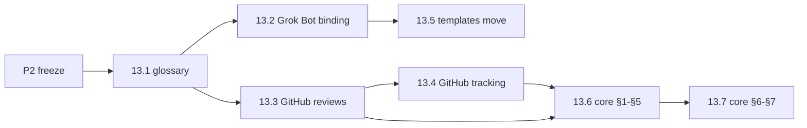

# Spec: portable eng-crew (pluggable runtimes and tools)

Status: draft v0.1 (2026-10-29). Owner: coordinator. Changes land through
`crew:spec` PRs (review pass only, merge on the owner's merge-ok). Umbrella:
[#110](https://github.com/mw-ding/eng-crew/issues/110).

## 1. Goal

Make eng-crew **installable on more than one agent runtime** and **workable
against more than one toolset**, chosen at install time. The protocol core
becomes runtime- and tool-agnostic; runtimes and tools become configurable
bindings. The first new runtime is a local tmux crew: one coordinator session
(Claude Code or Codex) that creates, briefs, monitors and tears down one
session per role, which the owner can attach to. The Grok Bot runtime with
GitHub stays a supported default profile with no behaviour change, and every
merge gate in [protocol §7](../protocol.md#7-merge-gate-synthesizer) still
holds. Every roadmap issue in milestones M13 and M14 links this spec.

## 2. Requirements

- **P1. Runtime abstraction.** The core protocol does not assume a runtime.
  Each runtime binding answers the same questions: how a role is woken, how a
  role session or worker is created and torn down, how state passes between
  roles, and how stuck or crashed work is detected. Runtime-specific
  mechanics (per-PR watches, routine limits, the stuck-PR sweeper) move out of
  the core into the Grok Bot binding. Bindings: Grok Bot (today), CLI / tmux
  (M14), other runtimes later. (#110)
- **P2. Tool abstraction per concern.** The protocol speaks in abstract terms
  (change, verdict, state tag, marker, CI signal) defined in a glossary. Each
  concern is a named interface with swappable backends; GitHub is the first
  backend for all of them. (#110)

  | Concern | Today (GitHub) |
  |---|---|
  | Change (code hosting + change requests) | PRs, squash merge |
  | Review + verdicts | Formal `APPROVE` / `REQUEST_CHANGES` reviews |
  | Tracker | Issues, milestones, Projects |
  | State tags | `crew:*` labels |
  | Comments + markers | COMMENT reviews with hidden `crew:v1` lines |
  | CI signals | GitHub Actions checks |
  | Events / wake sources | GitHub webhooks via routines |
  | Owner channel | Chat with the coordinator |

- **P3. Minimum backend contract.** Each concern interface lists the minimum
  operations a backend must support and the invariant each protects. A
  backend declares what it cannot do. (#110, settled in #121)
- **P4. Install-time profile.** One profile picks one runtime and one backend
  per concern, plus identities and engines (for example `runtime=tmux,
  change=github, tracker=github`). A validator rejects a bad profile before
  anything renders. A renderer produces the role briefs and runtime templates
  from core + bindings + resolved profile, so the live copy is generated from
  this repo instead of mirrored by hand (spec R4 in
  [framework.md](framework.md), `crew:needs-mirror`). The mirror gate is then
  a drift check: the coordinator deploys the render to the live dir and its
  mirror comment carries a clean `check-skill-drift.py --project` result at
  the last touching commit
  ([mirror hold gate](../runtimes/grok-bot.md#mirror-hold-gate)).
  (#110, #122, #125, #128)
- **P5. Config layers.** The effective config resolves from four layers,
  lowest to highest precedence (#110 decision comment, resolver in #123):
  1. **Core defaults** (in eng-crew): abstract protocol, role rules,
     invariants, concern interfaces.
  2. **Default profile** (in eng-crew): today's GitHub setup for external
     projects.
  3. **Org / environment pack** (outside eng-crew, optional): an
     organization's own adapter pack and profile, kept in its own repo and
     pinned to an eng-crew version. It overrides default backends per
     concern.
  4. **Per-project config** (in the target project or the local install):
     runtime, backend per concern, identities, engines, overrides.
- **P6. No org-internal names here.** eng-crew never contains
  organization-internal tool names, commands, URLs or specs. Packs reference
  eng-crew, never the reverse. (#110, guard in #127)
- **P7. Default profile stays complete.** The default GitHub profile is a
  complete, working setup on its own, with no org pack. (#110, #124)
- **P8. GitHub + Grok Bot keeps working after every merge.** Each roadmap PR
  leaves today's runtime and backend working; structural (move/reword) and
  behavioural changes never share a PR. Box skills follow the mirror
  deferral in [§6](#6-decisions). (#110, #112, #140)

## 3. Invariants

Every runtime + backend combination must keep these (#110):

1. **Author ≠ reviewer identity**, or the documented single-identity rule:
   verdicts as COMMENT reviews with `pass=verdict` markers and a recorded
   owner merge-ok ([§6](#6-decisions), #111).
2. **Reviewer engine ≠ the engine that actually wrote the round**, unless a
   recorded waive applies (see [roles.md](../roles.md)).
3. **Evidence on the change head.** Every piece of evidence a verdict relies
   on lives on the change at its current head.
4. **Only the synthesizer lands** the change.
5. **The tool of record holds the audit trail** (tracker item → change →
   verdict → land), never only a chat or a terminal pane.

A backend or runtime that cannot express an invariant makes that profile
**unsupported**. It is never silently weakened. (#110)

## 4. Target layout

| Path | Contents | Created by |
|---|---|---|
| `docs/concepts.md` | Glossary of abstract terms, mapped to GitHub / Grok Bot | 13.1 (#113) |
| `docs/runtimes/README.md` | Runtime contract: what every runtime provides | 13.8 (#120) |
| `docs/runtimes/grok-bot.md` | Grok Bot binding: routines, watches, sweeper | 13.2 (#114) |
| `docs/runtimes/tmux.md` | tmux binding design and contract table | 14.1 (#130) |
| `docs/backends/github.md` | GitHub binding: reviews, markers, identities, tracking, labels | 13.3 (#115), extended by 13.4 (#116) |
| `docs/interfaces.md` | Concern interfaces and capability declaration | 13.9 (#121) |
| `docs/profile.md` | `crew.toml` schema, layers and precedence | 13.10 (#122), extended by 13.11 (#123) |
| `docs/packs.md` | External pack layout, version pin, direction rule | 13.15 (#127) |
| `templates/runtimes/grok-bot/` | Grok Bot routine templates | 13.5 (#117) |
| `templates/runtimes/tmux/` | tmux coordinator and role briefs | 14.8 (#137) |
| `profiles/default.toml` | Default GitHub + Grok Bot profile | 13.12 (#124) |
| `packs/github/manifest.toml` | GitHub pack manifest | 13.12 (#124) |
| `scripts/crew-config.py` | Profile `validate` and layered `resolve` | 13.10 (#122), 13.11 (#123) |
| `scripts/crew-render.py` | Renderer: profile to role briefs and templates | 13.13 (#125) |
| `scripts/crew` | tmux crew CLI (`up`, `down`, `spawn`, `kill`, ...) | 14.2 (#131) |

## 5. Milestones and slices

Each slice is one issue → one PR of about 100 changed lines (tests excluded;
pure text moves may be larger). Child issues say "Part of #110" and never
close the umbrella. Project board:
<https://github.com/users/md-mt/projects/10>.

### Pre-work

| ID | Issue | Scope | Depends on |
|---|---|---|---|
| P1 | #111 | Review and merge identity for roadmap PRs (decided) | none |
| P2 | #112 | Protocol freeze window for M13 Phase A | P1 |

### M13 Phase A: split (structural)

| ID | Issue | Scope | Depends on |
|---|---|---|---|
| 13.1 | #113 | Concepts glossary | P2 |
| 13.2 | #114 | Extract Grok Bot runtime binding | 13.1 |
| 13.3 | #115 | Extract GitHub binding: reviews, markers, identities | 13.1 |
| 13.4 | #116 | Extract GitHub binding: tracking, labels, linkage | 13.3 |
| 13.5 | #117 | Move routine templates under `templates/runtimes/grok-bot/` | 13.2 |
| 13.6 | #118 | Core protocol §1–§5 in abstract terms | 13.3, 13.4 |
| 13.7 | #119 | Core §6, §7 and gate registry in abstract terms; lifts freeze | 13.6 |

### M13 Phase B: interfaces, profiles, rendering

| ID | Issue | Scope | Depends on |
|---|---|---|---|
| 13.8 | #120 | Runtime contract | 13.2 |
| 13.9 | #121 | Backend interfaces and capability declaration | 13.7 |
| 13.10 | #122 | `crew.toml` profile schema and validator | 13.9 |
| 13.11 | #123 | Layered config resolver | 13.10 |
| 13.12 | #124 | Default GitHub profile and pack manifest | 13.10 |
| 13.13 | #125 | Renderer: profile to role briefs | 13.11, 13.12 |
| 13.14 | #126 | Templatize Grok Bot templates with a parity check | 13.5, 13.13 |
| 13.15 | #127 | External pack contract and internal-name guard | 13.12 |
| 13.16 | #128 | Replace manual mirroring with render-vs-live drift | 13.14 |
| 13.17 | #129 | Runbook: install by profile | 13.13 |
| 13.18 | #140 | Sync live box skills to `main` after M13 | 13.7; preferred after 13.14, 13.16 |

### M14: tmux crew runtime

| ID | Issue | Scope | Depends on |
|---|---|---|---|
| 14.1 | #130 | tmux runtime design doc | 13.8 |
| 14.2 | #131 | `crew up` / `crew down`: coordinator session | 14.1, 13.13 |
| 14.3 | #132 | `crew spawn` / `crew kill`: role sessions | 14.2 |
| 14.4 | #133 | `crew send`: reference-only messaging | 14.3 |
| 14.5 | #134 | `crew poll`: GitHub event poller, one consumer | 14.4 |
| 14.6 | #135 | Liveness heartbeat, `crew status`, watchdog | 14.3 |
| 14.7 | #136 | Serial land lock and concurrency cap | 14.3 |
| 14.8 | #137 | tmux render targets: coordinator and role briefs | 14.2, 14.3, 14.4, 14.5 |
| 14.9 | #138 | Observe: `crew attach`, `crew logs`, step summaries | 14.3 |
| 14.10 | #139 | End-to-end smoke on a sandbox repo and tmux runbook | 14.5–14.9 |

## 6. Decisions

| Date | Decision | Source |
|---|---|---|
| 2026-10-29 | **Config layers:** core defaults → default GitHub profile → org / environment pack outside eng-crew → per-project config. No org-internal names here; packs declare what they cannot support; default profile stays complete. | #110 (decision comment) |
| 2026-10-29 | **Where the abstraction lives (Q9):** docs + `crew.toml` profile + renderer + small CLI. | [#110](https://github.com/mw-ding/eng-crew/issues/110) body, "Open questions → where they are settled" table, row Q9 ("decided: docs + `crew.toml` profile + renderer + small CLI"); approved by the owner with the roadmap |
| 2026-10-29 | **Single identity:** all roles act from one GitHub account in the coordinator session. For roadmap PRs, verdicts are COMMENT reviews headed `[Vera/verdict] round <k> @ <sha7>` with review and validate markers and a final `pass=verdict` marker; this replaces the formal `APPROVED` gate for #110 roadmap PRs only. Every other §7 gate is unchanged; CI is never waived. | #111 |
| 2026-10-29 | **Chat merge-ok:** the owner OKs each roadmap PR in the coordinator chat; the coordinator records it as an `[Ash/steer] merge-ok (owner, chat) @ <sha7>` COMMENT review with a `pass=steer cmd=merge-ok cmd-id=chat` marker; the synthesizer pass re-checks §7 and squashes with `--match-head-commit`. Roadmap PRs carry `crew:hold` so the live Grok Bot crew no-ops. Folded into #130 as the single-identity profile rule. | #111 |
| 2026-10-29 | **Protocol freeze:** `docs/protocol.md`, `templates/` and `docs/roles.md` frozen for M13 Phase A (#113–#119) except Phase A roadmap PRs; lifts when #119 merges. | #112 |
| 2026-10-29 | **Mirror deferral:** roadmap PRs touching `docs/protocol.md` or `templates/` merge without the per-PR box-skill mirror; the coordinator posts the deferral to #140 and removes `crew:needs-mirror` (documented fail-open). A PR that changes live Grok Bot behaviour still waits for a real mirror. Box skills sync once after M13 in #140. | #112, #140 |
| 2026-10-29 | **Kickoff choices:** builders run as Claude subagents; the reviewer runs on Codex CLI; up to 5 independent issues in parallel; M13 before M14. | Owner kickoff, recorded on [#110](https://github.com/mw-ding/eng-crew/issues/110#issuecomment-6516621437) |

## 7. Open questions

| Question | Settled in |
|---|---|
| Q1 wake model, Q2 session lifetime, Q3 coordinator engine, Q6 concurrency, Q7 failure handling | #130 |
| Q4 protocol split (core vs Grok Bot specific) | #114–#119 |
| Q5 identities on one machine | #132 |
| Q8 relation to #102 (solo lane) and #109 (quota) | revisit after M14 |
| Q10 minimum backend contract and capability declaration | #121 |
| Q11 which second backend proves the abstraction | deferred (out of current scope) |
| Profile schema | #122 |
| Merge / override semantics between config layers | #123 |

## 8. Out of scope

- Organization-internal adapter packs (they live outside this repo; P6).
- Other agent runtimes beyond Grok Bot and tmux, and a second non-GitHub
  backend (Q11).
- Chat-platform owner channels (deferred).
- Changing any [§7](../protocol.md#7-merge-gate-synthesizer) merge gate for
  the Grok Bot runtime, other than the mirror gate in 13.16 (#128), which
  merges only on the owner's approval.
- Remote or cloud hosting of the tmux crew (local first).
- Product code of any repo the crew works on.
