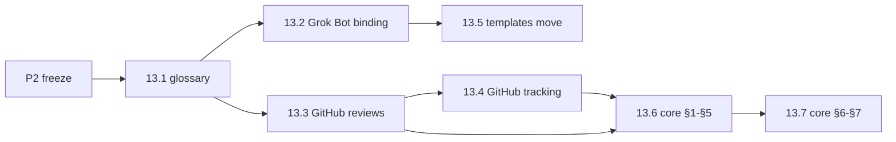

# Spec: portable mdstack (pluggable runtimes and tools)

Status: v0.4 (2026-11-07). Owner: coordinator. Changes land through
`crew:spec` PRs (review pass only, merge on the owner's merge-ok). Umbrella:
[#110](https://github.com/mw-ding/eng-crew/issues/110).

v0.4 ([#1217](https://github.com/mw-ding/eng-crew/issues/1217)) adds the
2026-11-07 design: four axes (roles, connectors, environments, harnesses),
the `knowledge` concern, generic actions
([P11](#2-requirements)) and the generic
[extension mechanism](#9-extension-mechanism). It also marks the sections
the M29–M34 plan supersedes. The new team spec
([#1216](https://github.com/mw-ding/eng-crew/issues/1216)) cites P1–P8 and
does not restate them. v0.4 changes no live gate or marker rule: the
[protocol](../protocol.md) still owns those.

## 1. Goal

Make mdstack **installable on more than one agent runtime** and **workable
against more than one toolset**, chosen at install time. The protocol core
becomes runtime- and tool-agnostic; runtimes and tools become configurable
bindings. The first new runtime is a local tmux crew: one coordinator session
(Claude Code or Codex) that creates, briefs, monitors and tears down one
session per role, which the owner can attach to. The Grok Bot runtime with
GitHub stays a supported default profile with no behaviour change, and every
merge gate in [protocol §7](../protocol.md#7-merge-gate-synthesizer) still
holds. Every roadmap issue in milestones M13 and M14 links this spec.

## 2. Requirements

- **P1. Runtime abstraction.** The core protocol does not assume a runtime.
  Each runtime binding answers the same questions: how a role is woken, how a
  role session or worker is created and torn down, how state passes between
  roles, and how stuck or crashed work is detected. Runtime-specific
  mechanics (per-PR watches, routine limits, the stuck-PR sweeper) move out of
  the core into the Grok Bot binding. Bindings: Grok Bot (today), CLI / tmux
  (M14), other runtimes later. (#110) From v0.4, a runtime is called an
  **environment**: it runs roles and implements the
  [generic actions](#2-requirements) (P11) with its own tools (tmux, herdr,
  Grok Bot). An environment is never a connector, and a connector never
  runs roles.
- **P2. Tool abstraction per concern.** The protocol speaks in abstract terms
  (change, verdict, state tag, marker, CI signal) defined in a glossary. Each
  concern is a named interface with swappable backends; GitHub is the first
  backend for all of them. (#110) A backend of one or more concerns is a
  **connector**. It reaches an external tool, such as the forge or a
  knowledge service.

  **Four axes (v0.4).** A profile varies along four independent axes:

  | Axis | Answers | Contract |
  |---|---|---|
  | Roles | Who does the work, in generic action terms | Role skills (M30, #1184, #1221) |
  | Connectors | Which external tools hold the record and knowledge | The concerns below ([interfaces](../interfaces.md)) |
  | Environments | Where roles run and how generic actions happen (P1) | [Runtime contract](../runtimes/README.md) and the actions contract (P11) |
  | Harnesses | Which agent CLI a role session launches and how it is woken and probed | [Harness adapters](../runtimes/harness-adapters.md) |

  A harness is its own axis, not a concern or an environment. One
  environment can run different harnesses per role, and one harness runs
  in several environments.

  | Concern | Today (GitHub) |
  |---|---|
  | Change (code hosting + change requests) | PRs, squash merge |
  | Review + verdicts | Formal `APPROVE` / `REQUEST_CHANGES` reviews |
  | Tracker | Issues, milestones, Projects |
  | State tags | `crew:*` labels |
  | Comments + markers | COMMENT reviews with hidden `crew:v1` lines |
  | CI signals | GitHub Actions checks |
  | Events / wake sources | GitHub webhooks via routines |
  | Owner channel | Chat with the coordinator |
  | Knowledge (v0.4) | None: repo docs only. First backend: Notion (M32, #1229) |

- **P3. Minimum backend contract.** Each concern interface lists the minimum
  operations a backend must support and the invariant each protects. A
  backend declares what it cannot do. (#110, settled in #121)
  - **`knowledge` (v0.4).** The minimum operations are read, search and
    propose-edit. A role never writes owner knowledge directly. Knowledge
    is context only: no verdict, marker, state tag or gate input lives
    there, so the tool of record (invariant 5) is unchanged. Pointers to
    private pages stay in the install, never in this repo (P6). The
    interface lands with its first backend (#1229).
  - **Harness adapters (v0.4).** The same rule applies on the harness axis.
    An adapter states each field of the
    [harness adapter interface](../runtimes/harness-adapters.md#fields) or
    declares it absent, and that interface defines what an absent field
    means. M30 (#1182) moves each harness's recipe into one adapter module.
- **P4. Install-time profile.** One profile picks one runtime and one backend
  per concern, plus identities and engines (for example `runtime=tmux,
  change=github, tracker=github`). From v0.4 it also picks a harness per
  role and, optionally, a `knowledge` backend. A validator rejects a bad profile before
  anything renders. A renderer produces the role briefs and runtime templates
  from core + bindings + resolved profile, so the live copy is generated from
  this repo instead of mirrored by hand (spec R4 in
  [framework.md](framework.md), `crew:needs-mirror`). The mirror gate is then
  a drift check: the coordinator deploys the render to the live dir and its
  mirror comment carries a clean `check-skill-drift.py --project` result at
  the last touching commit
  ([mirror hold gate](../runtimes/grok-bot.md#mirror-hold-gate)).
  (#110, #122, #125, #128)
- **P5. Config layers.** The effective config resolves from four layers,
  lowest to highest precedence (#110 decision comment, resolver in #123):
  1. **Core defaults** (in mdstack): abstract protocol, role rules,
     invariants, concern interfaces.
  2. **Default profile** (in mdstack): today's GitHub setup for external
     projects.
  3. **Org / environment pack** (outside mdstack, optional): an
     organization's own adapter pack and profile, kept in its own repo and
     pinned to an mdstack version. It overrides default backends per
     concern. From v0.4 a pack can also plug in connectors, harnesses,
     environment defaults, extra skills and tightening-only rules
     ([§9](#9-extension-mechanism)).
  4. **Per-project config** (in the target project or the local install):
     runtime, backend per concern, identities, engines, overrides.
- **P6. No org-internal names here.** mdstack never contains
  organization-internal tool names, commands, URLs or specs. Packs reference
  mdstack, never the reverse. (#110, guard in #127)
- **P7. Default profile stays complete.** The default GitHub profile is a
  complete, working setup on its own, with no org pack. (#110, #124)
- **P8. GitHub + Grok Bot keeps working after every merge.** Each roadmap PR
  leaves today's runtime and backend working; structural (move/reword) and
  behavioural changes never share a PR. Box skills follow the mirror
  deferral in [§6](#6-decisions). (#110, #112, #140)
- **P9. Versioned releases.** mdstack ships named deliverables as SemVer
  releases: a tag and a GitHub Release with one bundle, cut by a workflow
  only after the owner approves it. Packs pin a tag and installs record
  one; nothing auto-updates an environment. Inventory, packaging and
  compatibility in [deliverables.md](../deliverables.md); workflow, release
  gate, rollback and update path in [release.md](../release.md). (#145,
  #217, #218, #219)
- **P10. Changelog fragments.** Changes are recorded as per-PR fragments
  under `changes/unreleased/` and assembled into `CHANGELOG.md` at release
  cut. (owner, 2026-10-30, #264)
- **P11. Generic actions (v0.4).** Role and protocol text names actions
  generically, for example notify a role, wait for an event, claim an item,
  record a heartbeat, report status, post a marker or spawn a worker. It
  never names one environment's commands. Each environment maps every
  action to its own tools and marks the gaps. The **actions contract**
  ([#1218](https://github.com/mw-ding/eng-crew/issues/1218), M29) defines
  each action's semantics, inputs, outputs and outcomes, plus a CLI
  contract and the per-environment mapping table. Its vocabulary comes
  from the [#1213](https://github.com/mw-ding/eng-crew/issues/1213)
  inventory. Connectors, environments and harnesses implement it. The
  terminal CLI implementation is M32
  ([#1232](https://github.com/mw-ding/eng-crew/issues/1232)). Until then,
  today's briefs and commands stay in force. (owner, 2026-11-07, #1180)

## 3. Invariants

Every runtime + backend combination must keep these (#110):

1. **Author ≠ reviewer identity**, or the documented single-identity rule:
   verdicts as COMMENT reviews with `pass=verdict` markers and a recorded
   owner merge-ok ([§6](#6-decisions), #111).
2. **Reviewer engine ≠ the engine that actually wrote the round**, unless a
   recorded waive applies (see [roles.md](../roles.md)).
3. **Evidence on the change record.** Every piece of evidence a verdict relies
   on is inline in the body or signed reviews, never committed to the repo.
   Captures at or before head count only when validation at head confirms
   they still apply ([verification](../verification.md)).
4. **Only the synthesizer lands** the change.
5. **The tool of record holds the audit trail** (tracker item → change →
   verdict → land), never only a chat or a terminal pane.

A backend or runtime that cannot express an invariant makes that profile
**unsupported**. It is never silently weakened. (#110)

**Scoped express exception.** Only for a change whose effective flavor is
`express` ([protocol §3](../protocol.md#change-flavor)) and that carries
`crew:express`: invariant 1 is relaxed, since the builder identity posts the
selfgate record about its own change in place of a reviewer verdict, and
invariant 2 is relaxed only when `selfgate_engine = same`. Invariants 3–5
hold. The exception is written here for one label and never inferred by a
runtime, so it is not a silent weakening. A runtime that cannot run the
self-gate runs an express item in the crew lane.

## 4. Target layout

**Superseded (v0.4).** This table records the M13–R1 layout as built. The
target layout is now the modular one (`roles/`, `protocols/`, `actions/`,
`connectors/`, `environments/`, `harnesses/`, `core/`, `cli/`), with
dependency rules. It is specified in the team spec
([#1216](https://github.com/mw-ding/eng-crew/issues/1216)) and moved in M31
([#1222](https://github.com/mw-ding/eng-crew/issues/1222)). Until that move
lands, the paths below are current.

| Path | Contents | Created by |
|---|---|---|
| `docs/concepts.md` | Glossary of abstract terms, mapped to GitHub / Grok Bot | 13.1 (#113) |
| `docs/runtimes/README.md` | Runtime contract: what every runtime provides | 13.8 (#120) |
| `docs/runtimes/grok-bot.md` | Grok Bot binding: routines, watches, sweeper | 13.2 (#114) |
| `docs/runtimes/tmux.md` | tmux binding design and contract table | 14.1 (#130) |
| `docs/backends/github.md` | GitHub binding: reviews, markers, identities, tracking, labels | 13.3 (#115), extended by 13.4 (#116) |
| `docs/interfaces.md` | Concern interfaces and capability declaration | 13.9 (#121) |
| `docs/profile.md` | `crew.toml` schema, layers and precedence | 13.10 (#122), extended by 13.11 (#123) |
| `docs/packs.md` | External pack layout, version pin, direction rule | 13.15 (#127) |
| `templates/runtimes/grok-bot/` | Grok Bot routine templates | 13.5 (#117) |
| `templates/runtimes/tmux/` | tmux coordinator and role briefs | 14.8 (#137) |
| `profiles/default.toml` | Default GitHub + Grok Bot profile | 13.12 (#124) |
| `packs/github/manifest.toml` | GitHub pack manifest | 13.12 (#124) |
| `scripts/crew-config.py` | Profile `validate` and layered `resolve` | 13.10 (#122), 13.11 (#123) |
| `scripts/crew-render.py` | Renderer: profile to role briefs and templates | 13.13 (#125) |
| `scripts/crew` | tmux crew CLI (`up`, `down`, `spawn`, `kill`, ...) | 14.2 (#131) |
| `docs/deliverables.md` | Deliverables inventory, packaging, SemVer and compatibility rules | R1.1 (#145) |
| `docs/release.md` | Release workflow, release gate, rollback, update path | R1.1 (#145) |
| `scripts/changelog-cut.py` | Cuts `[Unreleased]` into a version section | R1.2 (#217) |
| `.github/workflows/release.yml` | Release workflow: validate, build, owner approval, tag, publish | R1.3 (#218) |

## 5. Milestones and slices

Each slice is one issue → one PR, sized by its unit of work (#978): a large
PR splits into logical commits, not more issues. The line counts in the
tables below are historical estimates, not a budget. Child issues say "Part of #110" and never
close the umbrella. Project board:
<https://github.com/users/md-mt/projects/10>. **Status** is the issue's
state: `open`, `done` or `dropped` (closed without landing); CI checks every
row has one (`check-repo.py --only spec-status`). A doc whose H1 says
"(design)" or "in design" names, in that H1 or its banner, an issue or
milestone here that is still open, or is listed with a reason in
`scripts/design-headers.txt` (`check-repo.py --only design-headers`).

**Superseded plan (v0.4).** The M15–M21 tables below are the v0.3 plan
and keep their v0.3 Status values; they are not re-synced here. M22–M28
were tracked as GitHub milestones only. The current plan is
[M29–M34](#m29-specs-and-contracts) (owner, 2026-11-07). M28 closed as
superseded and its issues moved to M30. Grok Bot and Hermes
adapters and herdr agent-API support are dropped for now. The deferred
M20.1 (remote role sessions) and M25.1 (owner environment) backlogs stay
open and are not dispatched.

M15–M21 carry out the #160 review
([final conclusion](https://github.com/mw-ding/eng-crew/issues/160#issuecomment-6532414226),
[milestones](https://github.com/mw-ding/eng-crew/issues/160#issuecomment-6532947853),
[backlog placement](https://github.com/mw-ding/eng-crew/issues/160#issuecomment-6533072952)).
Order: M15, M16 and M17 in parallel after M13; M18 after M16 and M17; M19
after M14 and M15; M20 after M14, M15, M17 and M21 (owner, 2026-11-03,
[#715](https://github.com/mw-ding/eng-crew/issues/715)); M21 after M17. Existing design
and backlog issues moved into a milestone carry the IDs given here.

### Pre-work

| ID | Issue | Scope | Depends on | Status |
|---|---|---|---|---|
| P1 | #111 | Review and merge identity for roadmap PRs (decided) | none | done |
| P2 | #112 | Protocol freeze window for M13 Phase A | P1 | done |

### M13 Phase A: split (structural)

| ID | Issue | Scope | Depends on | Status |
|---|---|---|---|---|
| 13.1 | #113 | Concepts glossary | P2 | done |
| 13.2 | #114 | Extract Grok Bot runtime binding | 13.1 | done |
| 13.3 | #115 | Extract GitHub binding: reviews, markers, identities | 13.1 | done |
| 13.4 | #116 | Extract GitHub binding: tracking, labels, linkage | 13.3 | done |
| 13.5 | #117 | Move routine templates under `templates/runtimes/grok-bot/` | 13.2 | done |
| 13.6 | #118 | Core protocol §1–§5 in abstract terms | 13.3, 13.4 | done |
| 13.7 | #119 | Core §6, §7 and gate registry in abstract terms; lifts freeze | 13.6 | done |

### M13 Phase B: interfaces, profiles, rendering

| ID | Issue | Scope | Depends on | Status |
|---|---|---|---|---|
| 13.8 | #120 | Runtime contract | 13.2 | done |
| 13.9 | #121 | Backend interfaces and capability declaration | 13.7 | done |
| 13.10 | #122 | `crew.toml` profile schema and validator | 13.9 | done |
| 13.11 | #123 | Layered config resolver | 13.10 | done |
| 13.12 | #124 | Default GitHub profile and pack manifest | 13.10 | done |
| 13.13 | #125 | Renderer: profile to role briefs | 13.11, 13.12 | done |
| 13.14 | #126 | Templatize Grok Bot templates with a parity check | 13.5, 13.13 | done |
| 13.15 | #127 | External pack contract and internal-name guard | 13.12 | done |
| 13.16 | #128 | Replace manual mirroring with render-vs-live drift | 13.14 | done |
| 13.17 | #129 | Runbook: install by profile | 13.13 | done |
| 13.18 | #140 | Sync live box skills to `main` after M13 | 13.7; preferred after 13.14, 13.16 | open |

### M14: tmux crew runtime

| ID | Issue | Scope | Depends on | Status |
|---|---|---|---|---|
| 14.1 | #130 | tmux runtime design doc | 13.8 | done |
| 14.2 | #131 | `mdstack up` / `mdstack down`: coordinator session | 14.1, 13.13 | done |
| 14.3 | #132 | `mdstack spawn` / `mdstack kill`: role sessions | 14.2 | done |
| 14.4 | #133 | `mdstack send`: reference-only messaging | 14.3 | done |
| 14.5 | #134 | `mdstack poll`: GitHub event poller, one consumer | 14.4 | done |
| 14.6 | #135 | Liveness heartbeat, `mdstack status`, watchdog | 14.3 | done |
| 14.7 | #136 | Serial land lock and concurrency cap | 14.3 | done |
| 14.8 | #137 | tmux render targets: coordinator and role briefs | 14.2, 14.3, 14.4, 14.5 | done |
| 14.9 | #138 | Observe: `mdstack attach`, `mdstack logs`, step summaries | 14.3 | done |
| 14.10 | #139 | End-to-end smoke on a sandbox repo and tmux runbook | 14.5–14.9 | done |
| 14.11 | #172 | `mdstack kill` refuses to remove unlanded work | 14.3 | done |

### M14.1: tmux hardening (dry-run fixes)

Fixes from the 14.10 dry runs and live sandbox run; 14.1a–d gate the 14.10
live run.

| ID | Issue | Scope | Depends on | Status |
|---|---|---|---|---|
| 14.1a | #230 | Watcher never wedges; wake on queue growth; `mdstack drain` | 14.10 dry run | done |
| 14.1b | #231 | Process, env and safety: no orphans, coordinator-only guard, pre-trust, sandbox env | 14.10 dry run | done |
| 14.1c | #232 | Rounds, claims and probes: no deadlock on unchanged head, per-pass claims, restart after done | 14.10 dry run | done |
| 14.1d | #233 | Briefs: crew path, land lock, docs paths, step summaries, `gh -R`, standing grant, validate order | 14.10 dry run | done |
| 14.1e | #234 | Second local dry run: zero manual unblocks | 14.1a–14.1d | done |
| 14.1f | #250 | Restart without duplicate PRs, Codex hooks gate, read-only state writes, `.crew` exclude | 14.1e dry run | done |
| 14.1g | #251 | Briefs: dialog handling, adopt an existing PR, render the role | 14.1e dry run | done |
| 14.1h | #255 | Coordinator never auto-applies a merge-ok | 14.10 live run | done |
| 14.1i | #257 | CI lint for rendered tmux briefs (regression guard) | 14.1h | done |
| 14.1j | #265 | `crew`: refuse placeholder paths in RESOLVED profile values (closes F5 bypass) | 14.10 live run | done |
| 14.1k | #266 | tmux briefs: state labels follow the verdict; asks closed by COMMENT review | 14.10 live run | done |

### M14.3: tmux polish

Small tmux fixes that don't block usability, after the M14.2 release (owner,
2026-11-01). Each Scope cell names the merged PR.

| ID | Issue | Scope | Depends on | Status |
|---|---|---|---|---|
| 14.3a | #301 | `mdstack guard` counts open owner asks as work in flight (PR #355) | M14.2 | done |
| 14.3b | #270 | tmux briefs write `--body-file` scratch files under the state dir (PR #356) | M14.2 | done |
| 14.3c | #303 | The reviewer posts the §6 intake ack when it picks up a PR (PR #357) | M14.2 | done |
| 14.3d | #312 | One kill-and-respawn for a stuck synthesizer after a failed nudge (PR #359) | M14.2 | done |
| 14.3e | #262 | Codex trust: `mdstack up` pre-trusts a Codex coordinator with the `projects` table (PR #365) | M14.2 | done |

### R1: versioned release

| ID | Issue | Scope | Depends on | Status |
|---|---|---|---|---|
| R1.1 | #145 | Deliverables and versioned release CI/CD (design) | 13.13, 13.14, 13.15 | done |
| R1.2 | #217 | CHANGELOG cut script | R1.1 | done |
| R1.3 | #218 | Release workflow with owner approval | R1.1, R1.2 | done |
| R1.4 | #219 | First cuts: retro-tag v1.0.0 and cut v2.0.0 after M14 | R1.3, 14.10 | done |
| R1.5 | #235 | Deliverables manifest and unclassified-path check | R1.1 | done |
| R1.6 | #236 | Release bundle build | R1.5 | done |
| R1.7 | #246 | Attach the release bundle in `release.yml` | R1.6 | done |
| R1.9 | #275 | Ship `check-repo.py` in the release bundle and smoke-test the extracted bundle | R1.4 | done |
| R1.10 | #276 | R1 close-out: README status sync and install-from-release steps | R1.4 | done |
| R1.11 | #277 | Release v2.0.1 (bundle fix #275, install steps #276) | R1.9, R1.10 | done |

### M15: runtime contract v2

Runtime contract amendments and the harness and session-backend interfaces
(#160 rows
[3](https://github.com/mw-ding/eng-crew/issues/160#issuecomment-6531125583),
[4](https://github.com/mw-ding/eng-crew/issues/160#issuecomment-6531265464),
[5](https://github.com/mw-ding/eng-crew/issues/160#issuecomment-6531284681),
[13](https://github.com/mw-ding/eng-crew/issues/160#issuecomment-6532100410)).

| ID | Issue | Scope | Depends on | Status |
|---|---|---|---|---|
| 15.0 | #173 | Spec: add M15–M21 and 14.11 to the portable spec | M13 | open |
| 15.1 | #174 | C1: waiting costs no model turns | 13.8 | open |
| 15.2 | #175 | C5: run identity is a handle plus start time | 13.8 | done |
| 15.3 | #176 | C6: teardown only after provable landing | 13.8 | open |
| 15.4 | #177 | Harness adapter interface | 13.8 | done |
| 15.5 | #178 | Session backend interface | 15.2 | open |
| 15.6 | #179 | Bindings declare harness adapters and session backends | 15.1, 15.3, 15.4, 15.5 | open |
| 15.7 | #264 | Changelog fragments assembled at cut (tracker; parts 1–3) | R1.4 | open |
| 15.7a | #296 | Changelog fragments part 1: format, cut-time assembly, tree guards | — | done |
| 15.8 | #150 | Grok Bot runtime: close or accept the declared contract gaps (C1, C2, C3, C5) | 15.6 | open |
| 15.9 | #287 | Watcher wakes by the earliest owner-ask deadline (C8 doc/code mismatch) | — | open |

### M16: quality and governance

Inline pre-review check, `crew:sensitive`, gate-status comment,
owner-communication rules, persona in the profile and knowledge hygiene (#160
rows
[8](https://github.com/mw-ding/eng-crew/issues/160#issuecomment-6531125583),
[9](https://github.com/mw-ding/eng-crew/issues/160#issuecomment-6531795606),
[11](https://github.com/mw-ding/eng-crew/issues/160#issuecomment-6531918771),
[14](https://github.com/mw-ding/eng-crew/issues/160#issuecomment-6532191486),
[18](https://github.com/mw-ding/eng-crew/issues/160#issuecomment-6532327593)).

| ID | Issue | Scope | Depends on | Status |
|---|---|---|---|---|
| 16.1 | #180 | Pre-review check: builder protocol | M13 | open |
| 16.2 | #181 | Pre-review check: profile switch | 16.1 | open |
| 16.3 | #182 | Pre-review check: reviewer and synthesizer gates | 16.1, 16.2 | open |
| 16.4 | #183 | Pre-review check: before/after metrics | 16.3 | open |
| 16.5 | #184 | `crew:sensitive` class from deterministic path rules | M13 | open |
| 16.6 | #185 | Synthesizer gate-status comment | M13 | open |
| 16.7 | #186 | Owner-communication rules for the coordinator | M13 | open |
| 16.8 | #187 | Persona and signature in the profile | M13 | open |
| 16.9 | #188 | Knowledge routing and correct-not-add for always-loaded files | M13 | open |
| 16.10 | #189 | Upstream contribution gate | M13 | open |
| 16.11 | #143 | Evidence inline in PRs only; stop committing `evidence/` artifacts (lands before 16.1) | 13.7 | open |

### M17: bootstrap and doctor

Bootstrap design with `mdstack doctor`, propose-confirm-record, upgrade reload,
tool drift and a size budget (#160 rows
[12](https://github.com/mw-ding/eng-crew/issues/160#issuecomment-6531985646),
[15](https://github.com/mw-ding/eng-crew/issues/160#issuecomment-6532247500),
[17](https://github.com/mw-ding/eng-crew/issues/160#issuecomment-6532308283)).

| ID | Issue | Scope | Depends on | Status |
|---|---|---|---|---|
| 17.1 | #144 | Bootstrap: install mdstack into a new environment (design) | 13.8, 13.11, 13.13, 13.15, 14.1, R1.1–R1.4 | open |
| 17.2 | #190 | `mdstack doctor`: read-only checks, `--fix` and human steps | 17.1 | open |
| 17.3 | #191 | Bootstrap proposes, owner confirms, profile records | 17.1 | open |
| 17.4 | #192 | Upgrade: re-render and reload running roles | 17.1 | open |
| 17.5 | #193 | Doctor: tool-drift check | 17.2 | open |
| 17.6 | #194 | Self-test: size budget for always-loaded files | 17.1 | open |
| 17.7 | #165 | `crew-config`: expose resolve as a function returning the merged profile (structural refactor; lands before 17.3) | — | open |
| 17.8 | #166 | Packs: let an external pack add a new backend; record the pack path in `crew.toml`; feed the denylist in CI | — | open |

### M18: flavors and away mode

Crew flavors with intake and triage rigor discipline, and a recorded owner
away mode (#160 rows
[15](https://github.com/mw-ding/eng-crew/issues/160#issuecomment-6532247500),
[19](https://github.com/mw-ding/eng-crew/issues/160#issuecomment-6532357093)).

| ID | Issue | Scope | Depends on | Status |
|---|---|---|---|---|
| 18.1 | #156 | Crew flavors: per-project rigor/optimization presets with a metrics feedback loop (design) | — | open |
| 18.2 | #195 | Flavor schema and floor validator | 18.1, 16.2, 16.5 | open |
| 18.3 | #196 | Rigor decided at intake and triage | 18.2, 17.3 | open |
| 18.4 | #197 | Class rule inside one project | 18.2 | open |
| 18.5 | #198 | `/crew away`: recorded away mode with return brief | 16.7 | open |
| 18.6 | #199 | `/crew away --cap` and `--quiet` | 18.5 | open |
| 18.7 | #102 | Solo coding-agent lane (Claude/Codex deep sessions), as a `solo` flavor preset | — | open |
| 18.8 | #109 | Quota: cut Cursor/Grok Bot orchestration burn while Claude Code/Codex do the builds | — | open |

### M19: harness and backend adapters

Minimum harness targets beyond Claude Code and Codex, and the herdr session
backend (#160
[row 13](https://github.com/mw-ding/eng-crew/issues/160#issuecomment-6532100410)).

| ID | Issue | Scope | Depends on | Status |
|---|---|---|---|---|
| 19.1 | #200 | Harness adapter: Pi | 15.6, 14.10 | open |
| 19.2 | #201 | Harness adapter: Cursor | 15.6, 14.10 | open |
| 19.3 | #202 | Harness adapter: Muse | 15.6, 14.10 | open |
| 19.4 | #203 | Session backend: herdr | 15.6, 14.10 | open |
| 19.5 | #170 | tmux runtime: verify Codex as coordinator (wake line + turn-end notify) on the real CLI | — | open |

### M20: multi-device

Host inventory, host readiness and hardened remote calls (#160
[row 6](https://github.com/mw-ding/eng-crew/issues/160#issuecomment-6531687881)),
**runner first** (owner, 2026-11-03,
[#715](https://github.com/mw-ding/eng-crew/issues/715)). The first second
host has no forge access, so M20 delivers a remote test runner on
forge-less hosts: the primary is the forge gateway and seeds the host over
the hardened call, the host runs the forge-free checks at a head, results
come back by reference, and an unreachable runner falls back to a local run
without blocking a gate. Design:
[multi-device, forge-less hosts](../runtimes/multi-device.md#forge-less-hosts-remote-test-runner).
Remote role sessions (placement, remote lifecycle, wake, partition, attach)
and any forge relay move to a follow-up milestone. Real-device cases are
logged in [#716](https://github.com/mw-ding/eng-crew/issues/716).

| ID | Issue | Scope | Depends on | Status |
|---|---|---|---|---|
| 20.0 | #715 | Forge-less hosts, remote test runner first (design update and re-scope) | 20.1 | open |
| 20.1 | #158 | Multi-device crew: coordinator runs role sessions across devices on a private overlay network (design) | — | open |
| 20.2 | #204 | Host inventory and project affinity in the profile | 20.1 | done |
| 20.3 | #205 | `mdstack host check` and `mdstack hosts` | 20.2, 17.2 | done |
| 20.4 | #206 | `mdstack host prepare`; seeds a forge-less host's mirror from the primary | 20.3, 20.6 | open |
| 20.6 | #208 | Hardened remote call and remote runner | 20.1 | open |
| 20.7 | #209 | Two-host dry run: primary plus a forge-less runner host (owner-run, #716) | 20.13–20.16 | open |
| 20.12 | #349 | Add-a-runner-host runbook and host rows in the tmux contract table | 20.15 | open |
| 20.13 | #726 | Forge-less host capability: `forge = false` | 20.2, 20.3 | open |
| 20.14 | #727 | Runner job verbs: forge-free checks at a head | 20.4, 20.6 | open |
| 20.15 | #728 | `mdstack runner` client with local fallback | 20.13, 20.14 | open |
| 20.16 | #729 | Runner results as evidence | 20.15 | open |

Moved to the remote role sessions follow-up milestone: 20.5 (#207,
placement in `mdstack spawn`), 20.8 (#345, remote run lifecycle), 20.9 (#346,
remote wake and messages), 20.10 (#347, partition handling for role runs)
and 20.11 (#348, remote attach and logs), plus a forge relay if one is
needed later.

### M21: runtime handoff

Cross-runtime handoff with read-only fallback, idempotent transfer and
retry-until-ack (#160
[row 16](https://github.com/mw-ding/eng-crew/issues/160#issuecomment-6532279114)).

| ID | Issue | Scope | Depends on | Status |
|---|---|---|---|---|
| 21.1 | #157 | Runtime handoff: pause one crew runtime and resume the same work in another (design) | — | open |
| 21.2 | #210 | Ownership marker and read-only fallback | 21.1 | open |
| 21.3 | #211 | Handoff manifest and idempotent transfer | 21.2 | open |
| 21.4 | #212 | Prompt stop and resume | 21.3 | open |
| 21.5 | #213 | Dry-run handoff | 21.4 | open |

### M29: specs and contracts

The roadmap the owner approved on 2026-11-07
([#1180](https://github.com/mw-ding/eng-crew/issues/1180#issuecomment-6703873341),
[M34](https://github.com/mw-ding/eng-crew/issues/1180#issuecomment-6703974869)).
Order: M29, M30, M31, M32, M33, M34. Within a milestone, the order follows
each issue's `Depends on` lines, shown below. The review level per
milestone is the issue's recorded flavor. Docs only.

| ID | Issue | Scope | Depends on | Status |
|---|---|---|---|---|
| 29.1 | #1216 | Team spec: requirements, module layout, dependency rules | — | open |
| 29.2 | #1217 | This spec at v0.4 | — | open |
| 29.3 | #1218 | Actions contract: vocabulary, CLI contract, per-environment mapping | — | open |
| 29.4 | #1219 | `docs/specs/` in the essential project doc set | — | open |
| 29.5 | #1220 | Baseline metrics before the reorganisation | — | open |

### M30: decouple in place

Refactor only: no behaviour change and no silent fixture changes.

| ID | Issue | Scope | Depends on | Status |
|---|---|---|---|---|
| 30.1 | #1184 | Reviewer role skills pilot: one canonical source plus runtime fragments | — | open |
| 30.2 | #1221 | Canonical role skills for the other roles | 30.1 | open |
| 30.3 | #1182 | Harness adapters: one module per harness | — | open |
| 30.4 | #1183 | Session-backend capability boundary | 30.3 | open |
| 30.5 | #1185 | Role registry from each role's canonical skill | 30.1 | open |

### M31: modular reorganisation

One cutover and a major release.

| ID | Issue | Scope | Depends on | Status |
|---|---|---|---|---|
| 31.1 | #1222 | Move-only reorganisation into the modules | — | open |
| 31.2 | #1223 | `packs/github` becomes `connectors/github` | 31.1 | open |
| 31.3 | #1224 | Tests per module; dependency rules in `check-repo` | 31.1 | open |
| 31.4 | #1225 | Bootstrap scaffolds `docs/specs/` | 29.4 | open |
| 31.5 | #1187 | Synthesizer inbox full replay | — | open |
| 31.6 | #1176 | Lead first ack without a status dir | — | open |
| 31.7 | #1236 | Pack plug-in loading and conformance kit ([§9](#9-extension-mechanism)) | 31.2, 29.3 | open |
| 31.8 | #1226 | Major release cut and migration note | 31.1–31.7 | open |
| 31.9 | #1178 | Home-level layout cutover | 31.8 | done |

### M32: team beyond eng

| ID | Issue | Scope | Depends on | Status |
|---|---|---|---|---|
| 32.1 | #1227 | Role classes: owner-facing seats, internal staff, team heads | 29.1 | open |
| 32.2 | #781 | Coordinator display title | — | open |
| 32.3 | #1228 | Seat placeholders and a seat template | — | open |
| 32.4 | #1229 | `knowledge` connector: first backend | 29.3 | open |
| 32.5 | #1230 | Core memory layer | — | open |
| 32.6 | #1231 | On-demand role lifecycles | — | open |
| 32.7 | #1232 | Generic-action CLI subcommands (P11) | 29.3 | open |

### M33: rename

| ID | Issue | Scope | Depends on | Status |
|---|---|---|---|---|
| 33.1 | #1233 | CLI rename with a compatibility shim | 31.8 | open |
| 33.2 | #1234 | Repository rename and repo-keyed state names | 33.1 | open |
| 33.3 | #1235 | Settle the owner's old private design repo | — | open |

### M34: public documentation and major release

| ID | Issue | Scope | Depends on | Status |
|---|---|---|---|---|
| 34.1 | #1237 | Docs consolidation for the modular structure | 33.1, 33.2 | open |
| 34.2 | #1238 | Getting-started, pack-author and migration guides | 34.1 | open |
| 34.3 | #1239 | Major release cut with release notes for M29–M34 | 34.1, 34.2 | open |

### M45: recover runs and preserve queue state

Added by its status-sync slice #1670, part of
[#1644](https://github.com/mw-ding/mdstack/issues/1644). M45 opened before
the spec bookends (#259) landed, so this section is a one-time amendment
made at close. Scope comes from
[Riley's readiness pass](https://github.com/mw-ding/mdstack/issues/1644#issuecomment-6788963909):
nine builds from ten members, plus two follow-ups. Every row has shipped.

| ID | Issue | Scope | Depends on | Status |
|---|---|---|---|---|
| B1 | #1536 | A missing expected CI check never reads as green (PR #1658) | — | done |
| B2 | #1633 | Wake the lead for a builder idle after an API error (PR #1655) | — | done |
| B3 | #1639 | Reviewer notify refusal: diagnosis only, caller error, no PR | — | done |
| B4 | #1020 | Isolate malformed reviewer work refs in the pool and scheduler (PR #1660) | — | done |
| B5 | #1005 | Count reviewer rounds after the canonical steer resume (PR #1656) | — | done |
| B6 | #631, #1074 | Select the next eligible engine; quota-stopped runs restart on it (PR #1657) | — | done |
| B7 | #738 | Refuse Claude Code bypass as root before the worker window (PR #1652) | — | done |
| B8 | #1480 | tmux `new_session` raises when new-session exits 0 without a session (PR #1650) | — | done |
| B9 | #1082 | `mdstack up` ensures leads on a running session after the handoff ack (PR #1651) | — | done |
| F1 | #1654 | Deflake the upgrade lost-PID-file and persistent-watcher tests (PR #1664) | — | done |
| F2 | #1665 | M44 close capture (PR #1667) | — | done |
| — | #1003 | Reviewer verdict dedupe: closed as covered by PR #1163 | — | dropped |

Open questions M45 settled:

- **B1's required-check baseline.** The repo has no branch protection or
  ruleset to read, so the expected set is an explicit profile setting:
  `markdownlint`, `links` and `repo-guard` required, `lab` optional
  ([owner decision](https://github.com/mw-ding/mdstack/issues/985#issuecomment-6789266394)).
- **#1639 was a caller error.** The reviewer passed window index `0` to
  `action notify --to`, which resolves window names; no socket or lookup
  defect, so no code PR
  ([diagnosis](https://github.com/mw-ding/mdstack/issues/1639#issuecomment-6789247738)).
- **#1003 needed no build.** A current-path reproduction started no
  duplicate review at the same head and round.

Lessons:

- **Flaky default-branch tests.** A timing-dependent watcher test from
  #1620 failed main CI once and passed on rerun (#1654); F1 deflaked it.
  Rerun a flaky job, never waive it, and file the flake as an item.
- **Environment-dependent bootstrap smoke.** Inherited host probes can fail
  the bootstrap smoke before its intended assertion (#1668); fixture
  isolation is a follow-up outside M45.

Merge permission for M45 gate-contract and spec text was the owner's
[M45–M48 grant](https://github.com/mw-ding/mdstack/issues/985#issuecomment-6789266394).
M45 closes, and v7.8.0 is cut, after this slice merges.

### M46: verification exercises the real path

Opened by the spec slice #1669, part of
[#1645](https://github.com/mw-ding/mdstack/issues/1645). M35–M44 were
tracked as GitHub milestones only. Scope comes from
[Riley's readiness pass](https://github.com/mw-ding/mdstack/issues/1645#issuecomment-6793843567):
seven survivor items and one follow-up, so that each check runs the path
it claims to prove. Statuses were set by the status-sync slice #1690:
every build row has shipped; B7's owner-run A19 proof is still pending.

| ID | Issue | Scope | Depends on | Status |
|---|---|---|---|---|
| B1 | #1614 | Synthesizer refusal lab: the production session synthesizer against a stub stack backend (PR #1680) | #1669 | done |
| B2 | #1412, #1684 | Campaign assertions and retained failing cases (PR #1677); remaining failure-propagation forms split to #1684 under the stop rule (PR #1687) | #1669 | done |
| B3 | #1411 | Discovery-path absence tests (PR #1673) | #1669, after B1 and B2 start | done |
| B4 | #1413 | Production template test helper (PR #1674) | #1669, after B1 and B2 start | done |
| B5 | #1414 | Visible untracked files in `check-repo.py` (PR #1676) | #1669, after B1 and B2 start | done |
| B6 | #1493 | Unbuffered lab status-pull input (PR #1675) | #1669, after B1 and B2 start | done |
| B7 | #1470, #1469 | Faithful A19 source (linked worktree) and shared-server preconditions (PR #1681); the owner-run pinned-source A19 proof is still pending | #1669, after B1 and B2 start | done |
| F1 | #1649 | Detached-fixture capture-pipe lesson (docs) (PR #1672) | #1669 | done |
| F2 | #1688 | M45 close capture (PR #1689, approved, not yet merged) | — | open |

Decisions M46 settled:

- **#1469 consolidated into #1470.** The same A19 journey needs source and
  trust parity and the shared-server precondition before its failed
  bindings rerun; B7 carried both issues' criteria and evidence.
- **#1649 is a learning only.** Its fixture fix already shipped in #1637;
  F1 recorded the lesson and changed no test.
- **The #1677 split.** B2's rounds 3–7 each closed one failure-propagation
  form and the next review found another. Under the
  [cap-2 stop rule](https://github.com/mw-ding/mdstack/issues/985#issuecomment-6795892864),
  #1677 landed the proven parts and #1684 took the remaining forms.
- **One termination model.** #1684 replaced per-form patches with one rule:
  `exit` ends the step, and `return` its function, only in the step's own
  shell; an `exit`, `return` or exiting helper in a child shell (subshell,
  pipeline, background list, command substitution) is refused by name
  ([campaign harness](../campaign-harness.md)).
- **No protocol or merge-gate change.** B1 exercised the existing gate.
- **Owner steps for B7.** Checkout trust is already accepted for the
  checkout; the owner re-accepts it only if doctor reports it unmet. The
  live proof is a pinned-source A19 run from an ordinary terminal opened
  outside any agent session. mdstack never stops or restarts the shared
  server.

Lessons:

- **Fail closed early.** When each review round finds a new edge case,
  switch to rejecting what cannot be proven, and set a stop rule that
  splits the proven part from a follow-up (#1677, #1684).
- **Measure fixture impact before a sweeping lint rule.** A lint that
  changes what existing scenarios may contain needs its effect on those
  fixtures measured before it is tightened, not discovered round by round.

Merge permission for M46 spec, protocol, template and gate-contract text was
the owner's
[M45–M48 grant](https://github.com/mw-ding/mdstack/issues/985#issuecomment-6789266394),
recorded at each head. M46 has no release cut of its own; it ships in
7.10.0 (#1720) with M47's landed work and M48, and 7.9.0 is skipped. M46
closes after this slice merges.

### M47: installs and working copies

Opened by the spec slice #1691, part of
[#1646](https://github.com/mw-ding/mdstack/issues/1646). Scope comes from
[Riley's readiness pass](https://github.com/mw-ding/mdstack/issues/1646#issuecomment-6797511860):
seven builds, one PR per issue. No item below dispatches before this slice
merges. B3 waits for B1 and B2, and B6 waits for B5; every other row
depends only on this slice. Statuses were set by the status-sync
slice #1721 for the first five landed builds and by the closing
status-sync slice #1735 for B5 and B6: every row has landed.

| ID | Issue | Scope | Depends on | Status |
|---|---|---|---|---|
| B1 | #1344 | Project references (`FILE#repo`) kept through bootstrap, fetch and install (PR #1706) | #1691 | done |
| B2 | #1537 | Revision-bound memory: render reads core memory at one fresh remote-default SHA (PR #1703) | #1691 | done |
| B3 | #1090 | A true bootstrap no-op: an unchanged install writes nothing (PR #1716) | #1691, B1, B2 | done |
| B4 | #1595 | `mdstack connect` dials the inventory host's address (PR #1695) | #1691 | done |
| B5 | #1252 | A builder run cannot remove another run's working copy (PR #1707): run-owned Git metadata, `runtime.options.confinement` and a host guard that refuses `enforce` where the Codex sandbox cannot apply; items 2 and 5 (the live production-launch confinement proof) moved to #1739 by the [owner's choice](https://github.com/mw-ding/mdstack/issues/985#issuecomment-6816385952) | #1691 | done |
| B6 | #316 | Worktree root parity and conservative GC: `mdstack gc`, merged-only and dry-run first (PR #1740) | #1691, B5 | done |
| B7 | #281 | Ship the shared secret and glob primitives; keep `check-repo.py` internal (PR #1700) | #1691 | done |

Decisions M47 settles (the
[coordinator's record](https://github.com/mw-ding/mdstack/issues/985#issuecomment-6797570240)
under the owner's standing pre-approval; any of them changes on the owner's
word):

- **#1537 memory source.** Each render fetches the project's remote default
  branch once and reads core memory from that full SHA, frozen across the
  render's role outputs. A fetch or read failure refuses the render; it
  never falls back to stale or local memory. Core authority stays the
  reviewed project `memory/`.
- **#316 cleanup.** Lifecycle cleanup stays, plus a bounded, dry-run-first
  GC. Automatic removal covers merged work only, with C6 proof; every
  ambiguous case is kept and reported. Legacy keep lists stay, and #1166's
  recorded default (keep) is unchanged.
- **#316 provider deferred.** Git stays the only worktree provider.
  #316's AC4 is revised to: "The provider decision, with the treehouse
  alternative considered and deferred, is recorded under AC1; no provider
  profile key and no fake-`treehouse` tests." Its AC1–AC3 and AC5 stand.
  A later provider needs its own spec slice.
- **Sensitive heads.** B5, B6 (working-copy removal) and B7 (secret
  pattern move) get the full-diff sensitive check at each head; a
  sensitive head still needs the owner's per-change reason.

**B5's enforcing boundary (#1252).** A helper, claim check or prompt alone
does not satisfy #1252, because a raw shell can bypass them. B5 builds this
boundary:

1. **Own Git metadata per builder run.** Spawn gives each builder run a
   working copy with its own Git administrative directory (a local clone
   that borrows objects read-only from the shared checkout), not a linked
   worktree of the shared checkout. Its refs, index and worktree list
   belong to the run, so a commit or fetch never writes the shared
   checkout's metadata.
2. **OS write boundary.** The worker process runs under an OS-enforced
   write sandbox whose writable roots are exactly that run's working copy
   and the reporting paths the brief names (the crew state directory).
   Sibling run roots and the shared checkout, its common Git directory
   included, are read-only, so `git -C <shared> worktree remove`, `rm -rf`
   of a sibling and a write into a sibling's metadata all fail.
3. **Supported configurations.** A configuration enforces confinement
   only when its harness applies an OS write sandbox whose writable roots
   mdstack sets at launch. Today that is Codex with `permission_mode`
   `safe` or `auto` (workspace-write), with the shared common directory
   dropped from its added directories. `bypass` on any harness, Pi, Muse,
   Claude Code without an OS-sandboxed launch, and session-runtime workers
   (subagents in the coordinator's process) do not enforce. B5 may add a
   harness to the supported set only with the same proof. A role host
   applies the same rule on its host.
4. **Refusal.** A profile setting, `runtime.options.confinement`, takes
   `enforce` or `off`. Under `enforce`, spawn refuses an unsupported
   builder configuration before it claims a working copy or opens a
   window, naming the reason. B5 ships `off` as the default so a running
   crew keeps launching. Under `off`, the run record and `mdstack doctor`
   mark the run unconfined, and #1252's guarantee is not claimed for it.
5. **Proof.** Two live builder runs A and B through the production spawn
   and launch path, B with a nested evidence worktree: each of A's
   removal attempts on B fails and B stays usable, while A removes its own
   clean nested tree. C6 landed and discard checks stay as they are.

Owner steps: none for B1–B4 and B7, whose tests use fakes. B5 lists any
launcher or sandbox step its supported configurations need. Legacy #1166
trees stay an owner keep-list decision, not a B6 removal.

Decisions M47 settled:

- **The owner-shell confinement proof (#1465).** A crew worker already
  runs inside the host sandbox, so it cannot apply the nested Codex
  sandbox that B5's live proof needs (exit 71). The proof cannot run from
  a crew session; by the
  [owner's choice](https://github.com/mw-ding/mdstack/issues/985#issuecomment-6816385952)
  #1707 landed the host guard instead, and the live proof moved to #1739,
  which needs owner-shell preconditions.

Lessons (learning cards from the milestone close):

- **Keep a configured root's path semantics (#1732).** A
  repository-relative listing passed to a directory-relative
  `git ls-tree` silently rendered no memory below the Git root; #1703
  added `--full-tree` and a below-root regression.
- **Test both install orders (#1733).** A fresh team bootstrapped
  sibling-first failed doctor on a link its first repo had not yet
  installed; #1706 warns until the owning repo has an install record.
- **Mock a module's reference, not the shared module (#1734).** Patching
  `time.sleep` through the upgrade module also counted
  `subprocess.run` polling; #1703 replaced only the module-local
  reference.

Merge permission for M47 spec, protocol, template and gate-contract text was
the owner's
[M45–M48 grant](https://github.com/mw-ding/mdstack/issues/985#issuecomment-6789266394),
recorded at each head. M47 closes after this slice merges.

Release: all of M47 ships in 7.10.0 (#1720); 7.9.0 is skipped by the
owner's choice.

### M48: release integrity and reports

Opened by the spec slice #1697, part of
[#1647](https://github.com/mw-ding/mdstack/issues/1647). Scope comes from
[Riley's readiness pass](https://github.com/mw-ding/mdstack/issues/1647#issuecomment-6798439318):
nine builds, one PR per issue. No item below dispatches before this slice
merges. B4 (#1418) also waits for B5 (#978) and B2 (#1416); every other
row depends only on this slice. Statuses were set by the status-sync
slice #1721: every row has landed.

| ID | Issue | Scope | Depends on | Status |
|---|---|---|---|---|
| B1 | #1415 | Release cut checks the bump class against the published predecessor's pack manifests (PR #1705) | #1697 | done |
| B2 | #1416 | Release cut PRs use a non-closing release-issue reference; the issue closes after publication (PR #1711) | #1697 | done |
| B3 | #1417 | Released CHANGELOG sections are immutable outside a cut (PR #1704) | #1697 | done |
| B4 | #1418 | Moved or quoted prose keeps its meaning: qualifiers, slice linkage and closing keywords (PR #1719) | #1697, B5, B2 | done |
| B5 | #978 | Work-unit rule: an issue is a unit of work; one PR per issue, split into commits (PR #1710) | #1697 | done |
| B6 | #258 | C8 and §6: a deadline applies only a permitted default and supplies no merge-ok (PR #1699) | #1697 | done |
| B7 | #372 | The coordinator edits owner config only under a recorded authorization (PR #1708) | #1697 | done |
| B8 | #431, #1291 | One report skeleton for every role, with the team in signatures (PR #1709) | #1697 | done |
| B9 | #1314 | Remove `examples/agentconnect/` and every reference to it (PR #1702) | #1697 | done |

ACs and paths per row (the readiness pass has the full text and line
citations):

- **B1 (#1415).** Pin the published predecessor (D1) and a named positive
  manifest corpus; show they pass that release's validator, then run the
  candidate validator on them. A newly failing manifest refuses a
  same-major minor or patch, naming baseline, manifest, failing requirement
  and the required major. A major permits the break; an unreadable baseline
  fails with a repair step. Paths: `scripts/release-check.py` (or a new
  `scripts/release-compat.py`), `.github/workflows/release.yml`,
  `docs/release.md`, `docs/deliverables.md`, release-check tests and
  fixtures.
- **B2 (#1416).** A genuine cut carries exactly one same-repo release-issue
  reference in D2's form. That form satisfies linkage, is discovered for
  publication and never closes at merge. A successful publish posts the
  release URL, then closes the issue; a failure leaves it open. A missing,
  ambiguous or foreign target refuses with a correction step. Paths:
  `docs/release.md`, `docs/backends/github.md`, `docs/protocol.md` (Linked
  issue row and §7), `docs/roles.md`, `scripts/release-trigger.py`, the
  release workflow, builder and synthesizer policy fragments, the tmux
  linkage instruction and its tests.
- **B3 (#1417).** Against the merge base, `check-changelog-pr.py` rejects
  edits to or deletions of released sections, even with a valid new
  fragment, before either success path. A cut may add its section and
  consume fragments. Paths: `scripts/check-changelog-pr.py`,
  `CONTRIBUTING.md`, its test.
- **B4 (#1418).** (a) A doc move records a source-to-destination comparison
  of qualifiers, exceptions and scope. (b) Before opening a slice PR, the
  builder cites the newest signed allocation and compares its issue with the
  PR's link; a later change is reported in a signed note, never fixed by a
  body edit. (c) A body check flags every closing keyword outside the one
  intended closing line, honouring D2's form. It is a builder duty, not a
  new gate. Paths: `CONTRIBUTING.md`, `templates/policy/builder/build-pass.md`,
  `docs/roles.md`, a new `scripts/check-pr-linkage.py` and its test.
- **B5 (#978).** Coordinator planning and stage 1 state the owner's
  work-unit rule: one PR per issue, logical commits that pass where tests
  apply, review by commit and by the combined PR. Separate work keeps
  separate issues; M26 principle 9 (doc moves) stays. The ~100-line slice
  sizing in this section's preface stops being normative; historical tables
  stay. Paths:
  `docs/roles.md`, `docs/protocol.md`, this spec, the coordinator dispatch
  skill, builder and reviewer policy fragments.
- **B6 (#258).** C8 and §6 say a deadline wakes the coordinator to apply
  only a permitted default; elapsed time is never a merge-ok. A merge still
  needs a covering recorded grant or a per-PR owner record plus every gate.
  Paths: `docs/runtimes/tmux.md`, `docs/protocol.md` §6.
- **B7 (#372).** Before editing owner profile, team or config, the
  coordinator reads the recorded authorization and its scope. A covered edit
  is applied and reported with its key and record, with no new ask; an
  uncovered edit keeps the owner's config and goes to the owner-decision
  path. Paths: a coordinator policy fragment and its `SKILL.md` index,
  `docs/roles.md`, render fixtures.
- **B8 (#431, #1291).** `docs/roles.md` defines one outcome-first skeleton
  (headline, TL;DR, numbered changes or findings, compact evidence, next
  actor) and a fixed status set, applied to every role's human reports
  without changing markers, evidence sections or the usage line. Profile
  emoji have neutral fallbacks and one install-wide off switch. Signatures
  carry the team: resolved `team.name`, else the team-file basename; legacy
  single-repo installs omit it. Paths: `docs/roles.md`, `docs/profile.md`,
  `core/crew-config.py`, `core/crew-render.py`, `profiles/default.toml`,
  signing and report fragments, runtime templates and parity fixtures.
- **B9 (#1314).** Delete only `examples/agentconnect/`, its required-doc
  entries, links and catalog rows, and the `examples/**` manifest row;
  regenerate `docs/deliverables.md`; update the parity fixture's provenance
  comment only. Paths: the four files and the references the readiness pass
  lists.

Decisions M48 settles (the
[coordinator's record](https://github.com/mw-ding/mdstack/issues/985#issuecomment-6798475405)
under the owner's standing pre-approval; any of them changes on the owner's
word):

- **D1, #1415 baseline.** The latest published stable predecessor, pinned
  once per cut: v7.8.0 now, v7.9.0 if it publishes first. The corpus is
  named positive manifests plus an external-pack fixture from that snapshot.
- **D2, #1416 linkage.** A release-only non-closing form: `Refs #N` plus a
  whole-line `Release issue: #N`, exactly one same-repo target on a genuine
  cut. Ordinary PRs keep `Closes`. The release issue closes after the
  release URL exists and the notice succeeds.
- **D3, #431 and #1291.** Adopt the report skeleton and fold #1291's
  team-signature AC into #431: B8's one PR closes both issues.

Version classification, against the
[Versioning](../deliverables.md#versioning) table, for the v7.10.0 cut:

- **#1416 is major.** It adds a release-only exemption to the Linked issue
  gate, which §7 checks: a merge gate satisfied differently.
- **#1415 is minor.** The release approval gate's condition, release
  validation green, is unchanged; the new refusal only rejects a version the
  Versioning rules already forbid. If B1 changes the release approval row
  itself, it becomes major and is reclassified in its PR.
- **The rest add no gate.** B3 changes internal paths only (none); B4, B5
  and B7 add role duties and B8 optional profile keys with defaults
  (minor); B6 and B9 are wording or docs changes (patch). B8 changes no
  marker field or parsed output; if it does, it is major.

So with B2 as specified, v7.10.0 cannot be a minor. Before the cut, the
coordinator takes it to the owner, as the decision record requires: a
major cut with a `**Breaking:**` entry, or the owner's other call. No break
goes through as a minor.

Sensitive heads: B1–B3 (release and CI) and B9 (deletions) are forecast;
every build runs the full-diff sensitive check at each head, and a
sensitive head still needs the owner's per-change reason. Owner steps: none
for the nine builds; publication keeps the owner-actor approval flow.

Merge permission for M48 spec, protocol, template and gate-contract text is
the owner's
[M45–M48 grant](https://github.com/mw-ding/mdstack/issues/985#issuecomment-6789266394),
recorded at each head. A status-sync slice closes the milestone.

Questions M48 settled at close:

- **Release class.** The owner chose 7.10.0 (#1720) as a minor despite
  #1416's `**Breaking:**` entry; the entry and its migration step stay in
  the notes, and 7.9.0 is skipped
  ([decision](https://github.com/mw-ding/mdstack/issues/985#issuecomment-6814282786)).
  This was the owner's other call the classification above allows.
- **Order.** The cut ran before this status-sync slice, and the cut freeze
  held the slice until it landed, so the slice ships in the release after
  7.10.0.
- **D1 baseline.** 7.9.0 never published, so v7.8.0 stayed the pinned
  predecessor for the 7.10.0 cut.

Lessons:

- **A sensitive merge-ok is head-pinned (#1717).** A clean merge-up with an
  identical patch dropped #1711's owner merge-ok, though a verdict ports
  across it, so the owner had to answer the same ask again and the PR sat
  owner-blocked about 1.5 hours. Whether an owner merge-ok ports across
  an identical-patch merge-up is for triage under #1717; until then it
  does not.
- **Backstop re-nudge loop (#1715).** The lead backstop re-woke a lead
  every 60 seconds for land ids blocked on an owner `crew:sensitive`
  reason, with no state change, and each `blocked:` line re-woke the
  coordinator. Until #1715 is triaged, the lead settles owner-blocked land
  ids and the coordinator re-sends the land on the owner's answer.

### M49: responsive runs and attributable failures

Opened by the spec slice #1748, part of
[#1744](https://github.com/mw-ding/mdstack/issues/1744). Scope comes from
[Riley's readiness pass](https://github.com/mw-ding/mdstack/issues/1744#issuecomment-6819217773),
§4: seven members, one PR per issue; #1701 adds a PR only if its evidence
reproduces a gap. Every row is planned: its issue is `open`. No row
dispatches before this slice merges and the owner has upgraded the live
install to 7.10.0 from an operator terminal with dispatch paused ("upgrade"
below). B4 (#1714) also lands after B1 (#1715), so it integrates the settled
wait and wake contract. Sizes are non-test implementation lines, then test
lines, then the dispatch tier and effort.

| ID | Issue | Scope | Size | Depends on | Status |
|---|---|---|---|---|---|
| B1 | #1715 | Lead re-nudge backoff: hybrid retries, no timed re-nudge for acknowledged waits | 100–180; 100–180; default/medium | #1748, upgrade | open |
| B2 | #1682 | Merge-up delta detection accepts the published merge-up note | 30–80; 60–120; default/medium | #1748, upgrade | open |
| B3 | #1701 | Finished-builder reclaim: evidence disposition first, code only if a gap reproduces | 0 unless a gap reproduces; 60–120 if needed; default/medium | #1748, upgrade | open |
| B4 | #1714 | Work pause and resume: the coordinator stays, workers stop with work retained | 300–500 in 4–6 commits; 180–300; deep/high | #1748, upgrade, B1 | open |
| B5 | #1100 | Dequeue refusal names lead pool ownership, not a missing slot | 10–35; 30–60; default/medium | #1748, upgrade | open |
| B6 | #1659 | RemoteRun spawn fixture: visible diagnostics, explicit runner freshness | 0; 40–90; default/medium | #1748, upgrade | open |
| B7 | #1668 | Bootstrap smoke fixtures isolate irrelevant host doctor probes | 0; 40–90; default/medium | #1748, upgrade | open |

ACs and paths per row (the readiness pass has the full text and line
citations; runtime files are under `environments/terminal/crew.d/`, tests
under `dev/tests/environments/`):

- **B1 (#1715).** Unchanged acknowledged owner, hold or CI waits produce no
  repeated model nudge; other demand follows D2's cap; mixed waiting and
  actionable ids stay independent; a relevant new state wakes the lead at
  once; a watcher restart keeps timers and waits; ack and done identity and
  #1502's admission suppression stay correct. Paths: `watch.py`, `lead.py`,
  `route.py`, `docs/runtimes/tmux.md`, the builder, reviewer and
  synthesizer lead templates under `templates/runtimes/tmux/` for explicit
  wait association. Tests: `test-crew-watch.py`, `test-crew-lead.py`,
  `test-crew-route.py`, `test-crew-reviewer-pool.py`.
- **B2 (#1682).** Replay the original signed, head-pinned #1656 note and a
  conflict-resolved or differing merge-up through poll, route, the reviewer
  lead inbox and admission, keeping round 2 and creating no duplicate pass.
  Clean eligible merge-ups, moved heads, holds, foreign signatures and
  express keep their current handling. Accept the published merge-up form;
  never rewrite history to `fix`. Paths: `route.py`; `poll.py` or
  `reviewer-pool.py` only if the regression shows another delivery gap;
  conditional guidance in `templates/runtimes/tmux/builder.md`. Tests:
  `test-crew-route.py`, `test-crew-reviewer-pool.py`, `test-crew-poll.py`
  if touched.
- **B3 (#1701).** Trace merged builder, lifecycle reclaim, lead ack and
  completion, physical slot release and the next admissible build, with no
  manual terminal re-send. Keep the four-PR report and tell apart missed
  delivery, an unsafe-reap refusal, a busy child and a historical unknown.
  If existing behaviour suffices, record the evidence and learning and
  close; otherwise fix the reproduced gap in this issue. Add no second
  reaper and no weaker unlanded-work check; a retry defect belongs to B1.
  Paths to inspect: `route.py`, `kill.py`, `lead.py`, `dequeue.py`,
  `_shared.py`, `gc.py`, `templates/runtimes/tmux/builder-lead.md`.
  Coverage: `test-crew-route.py`, `test-crew-lead.py`, `test-crew-kill.py`,
  `test-crew-dequeue.py` if changed.
- **B4 (#1714).** A durable project barrier is written before any work
  stops. The coordinator survives; after pause success nothing dispatches,
  reviews, lands, restarts, runs a routine or cleans up, including direct
  CLI and queued work. Worktrees, records, claims, inboxes and status stay.
  A busy atomic land, a remote refusal, a surviving process or unreadable
  pause state never reports success. Repeated pause and resume are safe;
  restart and `up` cannot bypass a pause; resume rechecks live state,
  starts work once and clears no other stop or hold. Paths: new `pause.py`
  and `resume.py`; `_shared.py`, `down.py`, `watch.py`, `lead.py`, `up.py`
  and the admission and writer boundaries in `spawn.py`, `dequeue.py`,
  `route.py`, `reviewer-pool.py`, `land.py` and `train.py`, reusing the
  existing process, lock and preservation helpers; `docs/protocol.md`,
  `docs/runtimes/tmux.md` and the coordinator and lead templates. Tests:
  new `test-crew-pause.py` and `test-crew-resume.py`, plus the affected
  down, watch, lead, route, spawn, land, train and remote lifecycle cases.
- **B5 (#1100).** An eligible request excluded by lead ownership names the
  pool and the operator path; exhausted capacity still says capacity; an
  empty queue stays empty; mixed pools and `--ref` classify correctly.
  Dispatch and reclaim eligibility are unchanged. Paths: `dequeue.py`,
  `test-crew-dequeue.py`, `docs/runtimes/tmux.md` if help changes.
- **B6 (#1659).** RemoteRun spawn failures show stdout and stderr. The
  expected-healthy runner's freshness is explicit at the spawn boundary:
  show delayed setup with a controlled heartbeat age, then refresh the
  fixture heartbeat or use a bounded fixture interval. Production
  freshness, stale and down refusal coverage and the remote down
  preservation and removal assertions stay. Paths: `test-crew-spawn.py`,
  `test-crew-remote.py` if refusal coverage needs it; no product change.
- **B7 (#1668).** Smoke fixtures isolate only host-dependent doctor
  prerequisites, including in the copied subprocess bundle, so a failing
  irrelevant prerequisite cannot preempt the intended smoke assertion. Real
  CLI bootstrap, render and deploy, opt-in and dry-run safety, the
  started-session requirement, the creation-failure manifest and
  queue-once checks stay; real doctor failures keep separate coverage. A
  parent-only mock that cannot reach the subprocess is not enough. Paths:
  `test-crew-bootstrap.py`, `test-crew-doctor.py`; no product change.
  Guidance: `docs/lessons/2026-11-08-real-entrypoint-fixtures.md`.

Decisions M49 settles (the owner's
[decision](https://github.com/mw-ding/mdstack/issues/985#issuecomment-6831237295)
applies the coordinator's
[recommendations](https://github.com/mw-ding/mdstack/issues/1744#issuecomment-6819242524);
any of them changes on the owner's word):

- **D1, #1714 is a work pause.** Window 0 stays for owner conversation and
  control, and the watcher stays in observation mode: it keeps events but
  routes nothing, nudges no model and runs no GC or automatic default.
  Leads and workers are terminated with all work retained. An atomic land
  already started finishes first; while its lock is held, pause reports
  pausing or busy. A surviving process or unreachable host means an
  incomplete pause. Only an explicit owner resume ends it: resume rechecks
  ownership, heads, holds, CI and retained demand, starts eligible work
  once, keeps window 0, and clears only the project pause, never another
  hold, round count or landing stop.
- **D2, #1715 is the hybrid backoff.** Ordinary retries wait 60, 120, 240,
  480, then 900 seconds, capped per lead and keyed to unchanged pending
  demand and head identity. An acknowledged owner, hold or CI wait gets no
  timed model re-nudge while unchanged: demand is kept and fresh state is
  observed without a model. The lead wakes on the next relevant event
  without waiting for the deadline: a new handoff or head, a hold release
  or owner answer, a terminal CI state, a prerequisite pass or train
  completion, or admission becoming available. Only affected demand
  resets; timers and waits persist across a watcher restart, and a
  token-free fresh-state comparison recovers missed events. Untyped or
  unassociated status never silences other ids. Events wake leads and
  supply no permission. The intervals are defaults, not measured optimums.

Version classification, against the
[Versioning](../deliverables.md#versioning) table, for the next cut:

- **#1714 is major as specified.** A durable pause barrier that the land
  and train paths refuse on adds a condition to the
  [§7](../protocol.md#7-merge-gate-synthesizer) merge gate, and §9 gains
  project pause and resume control. If B4 instead stops landing only
  through the existing `stop-landing` and `resume-landing` record,
  unchanged, and adds commands and duties alone, it is minor and is
  reclassified in its PR.
- **#1682 is patch.** It makes dispatch recognize a merge-up note the
  protocol already allows, beside
  [verdict portability](../protocol.md#verdict-portability-and-delta-re-review);
  the portability gate and its marker fields are unchanged. If B2 changes
  §7 portability text or a marker's meaning, it is major.
- **The rest add no gate.** #1715 adds runtime behaviour and lead duties
  (minor); it becomes major if it newly requires a status or marker field.
  #1100 rewords a refusal (patch) with its exit code and any parsed output
  unchanged; a changed exit code or parsed output is major. #1701 is
  evidence or a fix restoring documented behaviour (patch or none); #1659
  and #1668 are test-only (patch).

So with B4 as specified, the next cut cannot be a minor. Before the cut,
the coordinator takes it to the owner: a major cut with a `**Breaking:**`
entry, or the owner's other call. No break goes through as a minor.

Sensitive heads: B3's conditional teardown fix and B4's stopping and
restarting of work are forecast; every build runs the full-diff sensitive
check at each head, and a sensitive head still needs the owner's
per-change reason. Shared plumbing: a change to `_shared.py` (B3 if it
reaches code, B4) selects dependent-component tests under the
[affected-tests policy](https://github.com/mw-ding/mdstack/issues/985#issuecomment-6763423100).
Owner steps: the 7.10.0 upgrade before any build; after B4 lands, one
supported-host pause and resume acceptance showing the coordinator survives
with no worker or land activity, batched with any upgraded B3 trace.

Merge permission for M49 spec, protocol, template and gate-contract text is
the owner's M49–M51 grant
([decision](https://github.com/mw-ding/mdstack/issues/985#issuecomment-6831237295),
[text](https://github.com/mw-ding/mdstack/issues/1744#issuecomment-6819303787)),
recorded at each head. A status-sync slice closes the milestone.

### M50: portable session contracts and stack binding

Opened by the spec slice #1749, part of
[#1747](https://github.com/mw-ding/mdstack/issues/1747). Scope comes from
[Riley's readiness pass](https://github.com/mw-ding/mdstack/issues/1747#issuecomment-6819946824):
six builds, one PR per issue, larger PRs split into reviewable commits. No
item below dispatches before this slice merges and the live install is
upgraded to 7.10.0 (U: an owner-terminal step with dispatch paused, after
the dry run succeeds; the install record still read 7.6.0 at the readiness
pass). Every row is planned: its issue is `open`. The order below is
priority, not a dependency; #1722 is last by risk. Sizes are estimated
changed non-test lines.

| ID | Issue | Scope | Size | Depends on | Status |
|---|---|---|---|---|---|
| B1 | #1723 | A primary host accepts a declared command checkout | 120–220 | #1749, U | open |
| B2 | #1724 | Session researchers are opt-in: an unset cap resolves to 0 (D1) | 50–100 | #1749, U | open |
| B3 | #1725 | Spec bookends follow the configured spec home or a specs-only external reference (D2) | 180–300 | #1749, U | open |
| B4 | #1726 | VCS-neutral negative control in the CLI evidence template | 15–35 | #1749, U | open |
| B5 | #1727 | Session Upgrading documents the one-time bootstrap prerequisite | 10–25 | #1749, U | open |
| B6 | #1722 | Additive stack binding: revision IDs and per-change readback (D3) | 350–550 | #1749, U | open |

ACs and paths per row (the readiness pass has the full text and line
citations):

- **B1 (#1723).** Accept an explicit `hosts.<primary>.checkout =
  "command"`. `host prepare` runs the host-owned `{argv, path}` declaration
  with checked exit and no shell, then writes the existing checkout
  receipt; `host check` reads the receipt and path and never runs the
  command. Only a declared, prepared checkout prints `ok project checkout`;
  a missing declaration, receipt or path, or a failed prepare, stays not
  ready. Git primaries and remote command checkout are unchanged. Prove
  accepted and refused cases with a local stub. Paths:
  `core/crew-config.py`, `environments/terminal/crew.d/host.py`, reusing
  `environments/terminal/remote/crew-remote.py`, `docs/profile.md`,
  `docs/runtimes/multi-device.md`, and their tests.
- **B2 (#1724).** Per D1, an unset session `researchers` cap resolves to 0
  and renders the four ordinary session briefs; a positive cap renders the
  sweep brief. Tmux keeps its default. The refusal for `triage.enabled =
  true` with zero researchers stays. The options table, session guidance
  and sample profile agree; the retained four briefs keep their bytes.
  Paths: `core/crew-config.py`, `docs/configuration/runtime-options.md`,
  `docs/runtimes/session.md`, `profiles/session.toml`, a new forward
  fragment, config and render tests.
- **B3 (#1725).** Bookends render the configured `docs.homes.specs`, with
  the default keeping today's `docs/specs/` bytes in every runtime. Per D2,
  an external reference makes the bookends name it, bootstrap create no
  local spec directory, and `docs-scan.py` record the external content as
  not checked. Spec-first opening and closing status-sync stay; a spec home
  supplies no merge permission or evidence waiver, and `[spec] paths`
  classification still covers repository spec changes. Paths:
  `core/crew-config.py`, `core/crew-render.py`,
  `templates/policy/coordinator/spec-bookends.md`,
  `environments/terminal/crew.d/bootstrap.py`, `scripts/docs-scan.py`,
  `docs/roles.md`, `docs/profile.md`, `docs/project-doc-set.md`,
  `docs/bootstrap.md`, `docs/project-docs.md`, their tests and render
  parity.
- **B4 (#1726).** State the requirement as a throwaway snapshot of the
  guarded paths at the checked head, with the guard's dependencies; label
  `git archive` as one Git recipe. A partial copy names what it copied and
  recreates setup on replay. The Git recipe, mutation assertion, guard
  argv, N1 nonzero / N2 zero and replay comparison are unchanged. Paths:
  `templates/evidence/cli-exit-stdout.md`, render and parity gates.
- **B5 (#1727).** Session Upgrading names a missing `install.json` as the
  condition for a one-time `mdstack bootstrap --project <absolute
  profile>` (pause dispatch, preview, apply), then normal upgrade, and says
  tmux-only adoption does not cover it. No adoption code. Paths:
  `docs/runtimes/session.md`, linking `docs/bootstrap.md`.
- **B6 (#1722).** Per D3, `change.land-stack` binds `<stack-top>`,
  `<stack-changes>` and `<stack-revisions>`; an optional
  `change.read-revision-id` binds each ID to that member's checked full
  head SHA. `land.change_placeholder` is honoured for every per-member
  operation in sync and async stack modes, and `land.stack_status =
  "per-change"` uses individual status, `[land.status]` and
  `change.read-landed` instead of `change.stack-status`. One accepted
  three-member stack sends exactly one request and records each member only
  after complete landed readback; a moved head, invalid ID, held member or
  red CI sends none. Every member still gets its own §7 checks. Paths:
  `core/crew-config.py`, `core/crew-render.py`,
  `environments/terminal/crew.d/land.py`,
  `environments/terminal/crew.d/_land_stack.py`, `docs/interfaces.md`,
  `docs/profile.md`, `docs/runtimes/session.md`, `docs/protocol.md`, the
  stack-land fixture pack, land and stack-land lab tests, render parity.

Decisions M50 settles (the
[owner's choices](https://github.com/mw-ding/mdstack/issues/985#issuecomment-6831237295),
applying the
[coordinator's recommendations](https://github.com/mw-ding/mdstack/issues/1747#issuecomment-6819967642);
any of them changes on the owner's word):

- **D1, #1724 opt-in researchers.** An unset session `researchers` cap
  resolves to 0. B2 ships a forward `**Breaking:**` fragment with the
  migration: a session profile that relies on the sweep, including one
  whose enabled triage relied on an omitted cap, sets a positive cap.
  Released CHANGELOG sections stay byte-identical.
- **D2, #1725 external spec home.** A specs-only `[docs] specs_external =
  "<canonical tracker-item or document URL>"`, mutually exclusive with an
  explicitly configured `homes.specs`. It is a reference, never a path or a
  command; other doc homes are unchanged, and no external fetch or write is
  added.
- **D3, #1722 additive stack binding.** List order is base-first and the
  last member is the representative change. Revision IDs are nonempty
  single safe tokens, checked before substitution, and persisted per member
  in the intent before the first status read or request; resume uses the
  recorded set and never re-resolves or resends. A revision ID is request
  metadata, never the head or landed SHA: `sha=` and `landed=` stay full
  hashes. In per-change mode, differing member states, queued versus
  landing included, are unknown for that pass: the intent is kept and no
  record is printed. Per-change mode refuses `stack_tests_against_tip =
  true` until a real combined-check receipt can be read. Legacy `<stack>`
  and `change.stack-status` operation, and every unbound or GitHub render,
  are unchanged.

Version classification, against the
[Versioning](../deliverables.md#versioning) table:

- **#1724 is major.** No §7 gate changes, but an installed session profile
  that omits `researchers` and relies on the sweep stops sweeping without
  an edit, which is the table's definition of breaking. Hence D1's
  `**Breaking:**` fragment and migration.
- **#1722 is minor.** Its stage 7 stack text adds an opt-in binding: new
  placeholders, an optional `land.stack_status` key with a legacy default,
  and a conditional operation required only when its placeholder is used.
  Every §7 gate, the tip gate and the full-SHA merge record are satisfied
  as before, and legacy mode is unchanged. Its request-identity and
  unknown-state rules still take the gate-contract path. If B6 lets
  per-change status satisfy a §7 gate, such as the tip gate, it is major
  and is reclassified in its PR.
- **The rest add no gate.** #1723 and #1725 add optional behaviour and an
  optional key (minor); #1726 and #1727 are wording and docs (patch).

So with B2 as specified, the release carrying M50 cannot be a minor. Before
that cut, the coordinator takes the class to the owner: a major with B2's
`**Breaking:**` entry, or the owner's other call. No break goes through as
a minor.

Sensitive heads: B1 (primary checkout command execution) and B6 (land
authority and status handling) are forecast; every build runs the
full-diff sensitive check at each head, and a sensitive head still needs
the owner's per-change reason. Owner steps: applying the compact
`merge_grant` profile line, then U (its dry run waited on that
compaction, #1746). A real non-Git primary checkout is an operator
deployment step; B1's acceptance uses a stub.

Merge permission for M50 spec, protocol, template and gate-contract text is
the owner's
[M49–M51 grant](https://github.com/mw-ding/mdstack/issues/985#issuecomment-6831237295)
([text](https://github.com/mw-ding/mdstack/issues/1744#issuecomment-6819303787)),
recorded at each head. A status-sync slice closes the milestone.

## 6. Decisions

| Date | Decision | Source |
|---|---|---|
| 2026-10-29 | **Config layers:** core defaults → default GitHub profile → org / environment pack outside mdstack → per-project config. No org-internal names here; packs declare what they cannot support; default profile stays complete. | #110 (decision comment) |
| 2026-10-29 | **Where the abstraction lives (Q9):** docs + `crew.toml` profile + renderer + small CLI. | [#110](https://github.com/mw-ding/eng-crew/issues/110) body, "Open questions → where they are settled" table, row Q9 ("decided: docs + `crew.toml` profile + renderer + small CLI"); approved by the owner with the roadmap |
| 2026-10-29 | **Single identity:** all roles act from one GitHub account in the coordinator session. For roadmap PRs, verdicts are COMMENT reviews headed `[Vera/verdict] round <k> @ <sha7>` with review and validate markers and a final `pass=verdict` marker; this replaces the formal `APPROVED` gate for #110 roadmap PRs only. Every other §7 gate is unchanged; CI is never waived. | #111 |
| 2026-10-29 | **Chat merge-ok:** the owner OKs each roadmap PR in the coordinator chat; the coordinator records it as an `[Ash/steer] merge-ok (owner, chat) @ <sha7>` COMMENT review with a `pass=steer cmd=merge-ok cmd-id=chat` marker; the synthesizer pass re-checks §7 and squashes with `--match-head-commit`. Roadmap PRs carry `crew:hold` so the live Grok Bot crew no-ops. Folded into #130 as the single-identity profile rule. | #111 |
| 2026-10-29 | **Protocol freeze:** `docs/protocol.md`, `templates/` and `docs/roles.md` frozen for M13 Phase A (#113–#119) except Phase A roadmap PRs; lifts when #119 merges. | #112 |
| 2026-10-29 | **Mirror deferral:** roadmap PRs touching `docs/protocol.md` or `templates/` merge without the per-PR box-skill mirror; the coordinator posts the deferral to #140 and removes `crew:needs-mirror` (documented fail-open). A PR that changes live Grok Bot behaviour still waits for a real mirror. Box skills sync once after M13 in #140. | #112, #140 |
| 2026-10-29 | **Kickoff choices:** builders run as Claude subagents; the reviewer runs on Codex CLI; up to 5 independent issues in parallel; M13 before M14. | Owner kickoff, recorded on [#110](https://github.com/mw-ding/eng-crew/issues/110#issuecomment-6516621437) |
| 2026-10-29 | **Inline-only evidence:** roadmap PRs carry their evidence inline, not under `evidence/`. | [#143](https://github.com/mw-ding/eng-crew/issues/143#issuecomment-6516943883), [#111 addendum](https://github.com/mw-ding/eng-crew/issues/111#issuecomment-6516944152) |
| 2026-10-30 | **Standing merge grant, all milestones:** extended from M13/M14 to every milestone of this project; it also covers status-only spec edits. | [#111 (all milestones)](https://github.com/mw-ding/eng-crew/issues/111#issuecomment-6535532827), [#111 (status-only spec edits)](https://github.com/mw-ding/eng-crew/issues/111#issuecomment-6537919568) |
| 2026-10-30 | **Release owner and gate:** the release owner identity and the release approval gate's interim convention. | [#219](https://github.com/mw-ding/eng-crew/issues/219#issuecomment-6537273776), [#243](https://github.com/mw-ding/eng-crew/pull/243#issuecomment-6536532290) |
| 2026-10-30 | **Spec bookends:** every milestone opens with a spec slice and closes with a status-sync slice. | [#259](https://github.com/mw-ding/eng-crew/issues/259), [#259 point 5](https://github.com/mw-ding/eng-crew/issues/259#issuecomment-6537919839) |
| 2026-10-30 | **Runtime direction, option A (#160):** mdstack keeps its own runtime and adopts firstmate's patterns and disciplines as contracts only, reimplemented with no code copied (#130 stands). The 19 row decisions are the overarching design for M15–M21 ([§5](#5-milestones-and-slices)). | [#160 final conclusion](https://github.com/mw-ding/eng-crew/issues/160#issuecomment-6532414226) |
| 2026-10-30 | **M14 freeze exception (14.11):** one owner-approved addition to the frozen M14 scope, #172 (`mdstack kill` refuses to remove unlanded work), a data-loss fix. | [#160 M14 update](https://github.com/mw-ding/eng-crew/issues/160#issuecomment-6532824780) |
| 2026-10-30 | **Changelog at cut time:** changes are recorded as per-PR fragments and assembled into `CHANGELOG.md` at release cut ([§2 P10](#2-requirements)), for every future milestone. Owner decision, recorded verbatim in #264. | [#264](https://github.com/mw-ding/eng-crew/issues/264) |
| 2026-10-31 | **M15+ hold lifted:** the owner lifted the M15+ hold for overnight autonomous execution. Still held for the owner (the standing #111 exclusions): substantive spec edits, merge-gate changes, live Grok Bot rule changes, `crew:sensitive` and any release beyond v2.0.1. | [#110 comment](https://github.com/mw-ding/eng-crew/issues/110#issuecomment-6540455617) |
| 2026-11-07 | **Four axes and generic actions:** roles, connectors, environments and harnesses vary independently ([P2](#2-requirements)). Roles name generic actions, and each environment implements them (P11). An environment is not a connector. | [#1213](https://github.com/mw-ding/eng-crew/issues/1213), [#1180 module structure](https://github.com/mw-ding/eng-crew/issues/1180#issuecomment-6703508949) |
| 2026-11-07 | **Self-hosted specs:** this repo keeps `docs/specs/` as its source of truth. Shape-changing work, such as the modular reorganisation, is specified here first. | [#1180 decision](https://github.com/mw-ding/eng-crew/issues/1180#issuecomment-6703556457) |
| 2026-11-07 | **Roadmap M29–M34:** the plan in [§5](#m29-specs-and-contracts). M28 is superseded. Grok Bot and Hermes adapters and herdr agent-API support are dropped for now. | [#1180 roadmap](https://github.com/mw-ding/eng-crew/issues/1180#issuecomment-6703873341), [#1180 M34](https://github.com/mw-ding/eng-crew/issues/1180#issuecomment-6703974869) |
| 2026-11-07 | **Generic extension mechanism:** this repo specifies the pack format, plug-in points, install flow and conformance kit in generic wording ([§9](#9-extension-mechanism)). A concrete pack is its own project, with its own specs in its own repo. | [#1217 scope addition](https://github.com/mw-ding/eng-crew/issues/1217#issuecomment-6703950176) |

## 7. Open questions

| Question | Settled in |
|---|---|
| Q1 wake model, Q2 session lifetime, Q3 coordinator engine, Q6 concurrency, Q7 failure handling | #130 |
| Q4 protocol split (core vs Grok Bot specific) | #114–#119 |
| Q5 identities on one machine | #132 |
| Q8 relation to #102 (solo lane) and #109 (quota) | revisit with M15 (owner to confirm) |
| Q10 minimum backend contract and capability declaration | #121 |
| Q11 which second backend proves the abstraction | deferred for the GitHub concerns; the `knowledge` concern's first backend is #1229 (v0.4) |
| Profile schema | #122 |
| Merge / override semantics between config layers | #123 |

## 8. Out of scope

- Organization-internal adapter packs (they live outside this repo; P6).
- Other agent runtimes beyond Grok Bot and tmux, and a second non-GitHub
  backend (Q11).
- Chat-platform owner channels (deferred).
- Changing any [§7](../protocol.md#7-merge-gate-synthesizer) merge gate for
  the Grok Bot runtime, other than the mirror gate in 13.16 (#128), which
  merges only on the owner's approval.
- Remote or cloud hosting of the tmux crew (local first).
- Product code of any repo the crew works on.
- A concrete pack's contents, even a public one: each pack is its own
  project ([§9](#9-extension-mechanism)).

## 9. Extension mechanism

Target design (v0.4). Pack loading and the conformance kit are built in
M31 ([#1236](https://github.com/mw-ding/eng-crew/issues/1236)). Until then,
today's config-only packs ([packs](../packs.md): `manifest.toml`,
`profile.toml`, render overlay, harness pointers) stay current. This
section adds no gate, marker or label.

**Pack format.** A pack is a directory with a `pack.toml` (today's
`manifest.toml` grows into it; #1236 settles the migration). It declares:

- the pack's name and its own version;
- the framework versions it supports, a pin or a range of releases (P9);
- what it provides at each plug-in point below, by name;
- the capability declaration of each connector it provides (P3).

**Plug-in points.** Built-in and pack adapters use the same interfaces and
are discovered by name:

| Point | A pack may add | Contract |
|---|---|---|
| Connectors | A backend for one or more concerns, `knowledge` included | P2, P3, [interfaces](../interfaces.md) |
| Harnesses | A harness adapter | [Harness adapters](../runtimes/harness-adapters.md) |
| Environment defaults | Default values for an environment it targets, such as session backend or host settings | [Runtime contract](../runtimes/README.md) and P11 |
| Extra skills | Role skills or skill variants beside the core ones | Role skills (M30) |
| Rules | Tightening only: a stricter flavor, extra gates or required skills | [Protocol](../protocol.md) floors |

A pack never loosens a core floor, gate, cap or invariant, and the loader
refuses a pack that tries. It never replaces the protocol or a core role.

**Config layering.** Pack values resolve as layer 3 of P5, between the
default profile and per-project config. Precedence is unchanged.

**Install flow.**

1. `install --pack <source>` fetches the pack at an exact commit or tag and
   checks its supported versions against the installed release. An
   unsupported version fails closed.
2. The install provenance records the pack's name, version, source and
   commit next to the framework release, as it already does for the
   framework.
3. Upgrade re-checks every installed pack against the new release and
   refuses one that does not support it. Nothing updates a pack on its own
   (P9).

**Conformance kit.** A `pack test` command runs the public actions-contract
and concern tests against the pack's adapters with fakes, so a pack can
run it in its own CI.

**Direction and wording.** Packs reference mdstack, never the reverse, and
this section stays generic (P6). An organisation's integrations are a pack
in that organisation's repo, with its own `docs/specs/`, applied at install
time.
